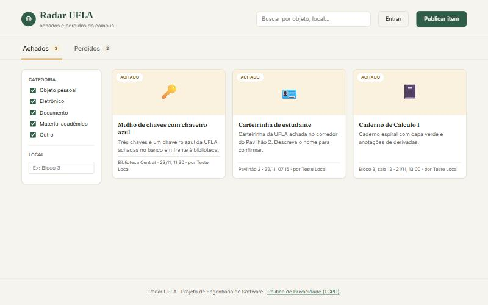
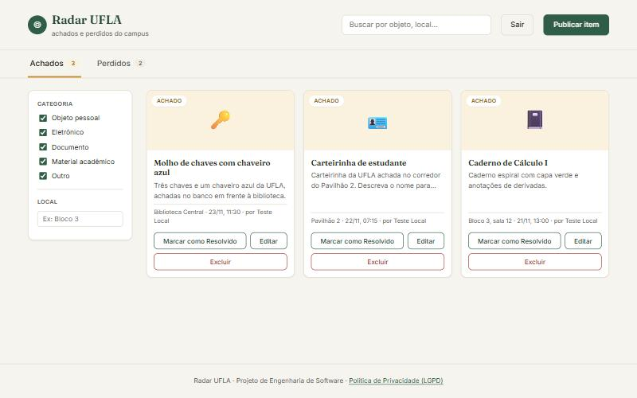
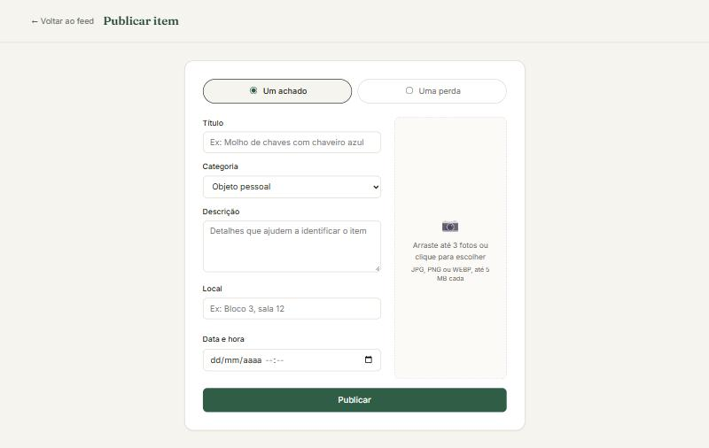

# Radar UFLA

> Trabalho de Engenharia de Software — 2026/2 | Universidade Federal de Lavras (UFLA)

## 1. Identificação do projeto

| Campo                       | Informação                                                                       |
| --------------------------- | -------------------------------------------------------------------------------- |
| Nome do projeto             | Radar UFLA                                                                       |
| Problema escolhido          | Achados e perdidos no campus da UFLA                                             |
| Turma/semestre              | Engenharia de Software — 2026/2                                                  |
| Professor                   | Prof. Johnatan Oliveira                                                          |
| Link do GitHub Project      | [Radar UFLA - Backlog](https://github.com/users/Matheus-Castro-Paula/projects/2) |
| Link da aplicação publicada | Não publicada; execução local pelo Docker (seção 10)                             |
| Link do vídeo final         | A publicar no YouTube até 30/11/2026                                              |

### Integrantes

| Nome completo                      | Usuário no GitHub       | Responsabilidade principal                                                     | Outras contribuições                |
| ---------------------------------- | ----------------------- | ------------------------------------------------------------------------------ | ----------------------------------- |
| Luis Gustavo Borges Vilela Marques | `@Luis-Marques06`       | PO / Scrum Master — backlog, Issues, organização das sprints, atas de reunião  | Apoio na documentação geral         |
| Bernardo Thomaz de Oliveira        | `@BernarDEVthomaz`      | Tech Lead — decisões de arquitetura e de projeto, apoio técnico a Front e Back | Apoio no plano e execução de testes |
| Rodrigo Penha Silva                | `@rodrigopenha13`       | Front-end — telas de feed, formulário de postagem, busca                       | Apoio na documentação de requisitos |
| Matheus de Castro Paula            | `@Matheus-Castro-Paula` | Back-end — API, autenticação, regras de negócio                                | Apoio na execução de testes         |
| Arthur Ramos Xisto                 | `@Artxisto`             | Back-end — API, modelagem de dados, banco de dados                             | Apoio na execução de testes         |

## 2. Resumo da solução

**Problema:** É comum que objetos sejam perdidos ou encontrados nos diversos espaços da UFLA (salas, corredores, refeitórios, biblioteca), sem que exista um canal centralizado para reconectar quem perdeu com quem encontrou. A comunicação atual depende de grupos informais de WhatsApp ou murais físicos, dificultando a busca e fazendo com que muitos itens nunca sejam devolvidos.

**Solução proposta:** O Radar UFLA é uma aplicação web em formato de feed dividida em duas abas principais: "Achados", onde qualquer estudante pode publicar foto e descrição de um objeto encontrado (local, horário e ponto de entrega), e "Perdidos", onde estudantes publicam itens que perderam. A plataforma conta com busca textual e filtros para acelerar a devolução.

**Público principal:** Estudantes, professores e servidores da UFLA.

**Funcionalidades prioritárias:**

- Publicação de itens encontrados (aba "Achados") e perdidos (aba "Perdidos")
- Filtros combinados e pesquisa por palavra-chave nos feeds
- Autenticação e gestão de anúncios pelo próprio usuário
- Upload local de fotos via Multer com armazenamento em volume Docker (ADR-08)
- Editar, marcar como resolvido e excluir o próprio anúncio direto no card (`RF-09`)
- Detalhes do anúncio em um modal, com galeria de fotos e contato do autor para usuários logados

### Telas

| Vitrine pública (sem login) | Vitrine do autor, com as ações do `RF-09` |
| --- | --- |
|  |  |

| Publicação de anúncio |
| --- |
|  |

Capturas de 23/11/2026, com a API rodando no Docker e dados de demonstração.

## 3. Comece por aqui

1. Consulte o documento de [Visão Geral](docs/visao-geral.md) e a [Especificação de Requisitos](docs/requisitos/requisitos.md).
2. Veja os modelos do sistema em [Modelagem](docs/modelagem/modelagem.md) e a estratégia de verificação em [Plano de Testes](docs/testes/plano-de-testes.md).
3. Acompanhe o fluxo de trabalho no [GitHub Project](https://github.com/users/Matheus-Castro-Paula/projects/2).
4. Veja o resultado final dos testes em [Evidências de Testes](docs/testes/evidencias-testes.md) e a entrega mais recente no relatório da [Sprint 8](docs/sprints/sprint-08.md).

## 4. Cronograma e pontuação

| Etapa         |       Data | Entrega central                                             |   Pontos | Tag obrigatória |
| ------------- | ---------: | ----------------------------------------------------------- | -------: | --------------- |
| Sprint 1      | 24/08/2026 | Problema, visão do produto, Scrum, GitHub e backlog inicial |      2,5 | `sprint-01`     |
| Sprint 2      | 14/09/2026 | Requisitos verificáveis e escopo da aplicação               |      2,5 | `sprint-02`     |
| Sprint 3      | 28/09/2026 | Modelagem e rastreabilidade                                 |      2,5 | `sprint-03`     |
| Sprint 4      | 13/10/2026 | Princípios de projeto e decisões locais                     |      2,5 | `sprint-04`     |
| Sprint 5      | 26/10/2026 | Padrões de projeto aplicados ao código                      |      2,5 | `sprint-05`     |
| Sprint 6      | 09/11/2026 | Arquitetura global da aplicação                             |      2,5 | `sprint-06`     |
| Sprint 7      | 16/11/2026 | Plano de testes e primeiras execuções                       |      2,5 | `sprint-07`     |
| Sprint 8      | 23/11/2026 | Validação final e estabilização                             |      2,5 | `sprint-08`     |
| Entrega final | 30/11/2026 | GitHub consolidado, slides e vídeo no YouTube               |      5,0 | `versao-final`  |
| **Total**     |            |                                                             | **25,0** |                 |

## 5. Como cada sprint é avaliada

Cada sprint vale **2,5 pontos**:

| Dimensão                               | Pontos | O que deve estar verificável                                               |
| -------------------------------------- | -----: | -------------------------------------------------------------------------- |
| Artefato central da disciplina         |   0,75 | Documento específico da etapa, tecnicamente consistente e completo         |
| Incremento da aplicação web            |   0,75 | Código, protótipo, teste ou funcionalidade que demonstre evolução concreta |
| Scrum e gestão do trabalho             |   0,50 | Issues, Sprint Backlog, responsáveis, critérios de aceitação e revisão     |
| GitHub, documentação e rastreabilidade |   0,50 | Commits, links, tag, organização e relação entre artefatos e código        |

## 6. Estado atual do projeto

Situação final, confrontada com os testes em [`evidencias-testes.md`](docs/testes/evidencias-testes.md).

| Funcionalidade | Requisito | Situação |
| --- | --- | --- |
| Cadastro e login com senha criptografada e token JWT | `RF-01`, `RNF-03` | **Implementado e testado** (CT-01, CT-02) |
| Vitrine com abas Achados/Perdidos, busca e filtros | `RF-04` a `RF-06` | **Implementado.** Filtro por período e busca sem acento ficaram de fora |
| Publicação de anúncio com data e hora | `RF-07` | **Implementado e testado** (CT-03, CT-04, CT-12) |
| Upload de até 3 fotos em volume local | `RF-08` | **Implementado e testado** (CT-03, CT-05, CT-06, CT-08, CT-09) |
| Editar, marcar como resolvido e excluir anúncio próprio | `RF-09`, `RN-02` | **Implementado e testado** (CT-11 e teste no navegador): editar, marcar como resolvido e excluir no card do autor |
| LGPD: sem dados pessoais na vitrine, sem foto e sem CPF em documento | `RN-04` | **Implementado e testado** (CT-07, CT-10, testes de M-05) |
| Política de privacidade | `RN-04` | **Implementado** ([`privacidade.html`](API/Front-End/privacidade.html)) |
| Acessibilidade WCAG 2.1 AA | `RNF-05` | **Auditado com axe-core:** 0 violações nas 5 páginas ([relatório](docs/testes/evidencias/2026-11-24_acessibilidade-axe.md)) |
| Suíte de testes automatizados (Jest + Supertest) | — | **60 testes passando**, 14 de 14 casos aprovados, 92,32% das linhas cobertas |
| Papéis de administrador, "Meus anúncios", comentários, denúncias, match e expiração | `RF-02`, `RF-03`, `RF-10` a `RF-14` | Não implementados; trabalho futuro justificado em [`evidencias-testes.md`](docs/testes/evidencias-testes.md#43-não-atendidos) |

## 7. Estrutura do repositório

```text
.
├── API/
│   ├── Back-End/
│   │   ├── src/
│   │   │   ├── config/              # Configuração do Sequelize (config.js) e Multer (upload.js)
│   │   │   ├── controllers/         # Controllers da API
│   │   │   ├── middlewares/         # authMiddleware.js (verificação do JWT)
│   │   │   ├── migrations/          # usuarios, anuncio, foto_anuncio, comentario
│   │   │   ├── models/              # Models Sequelize e associações
│   │   │   ├── routes/              # authRoutes.js, anuncioRoutes.js
│   │   │   ├── seeders/             # Usuário de demonstração
│   │   │   ├── services/            # Regras de negócio (AnuncioService.js, MidiaStorage.js)
│   │   │   ├── validations/         # Cadeia de validação (DataOcorrenciaHandler, FotosHandler, RegraLGPDHandler)
│   │   │   └── server.js
│   │   ├── tests/
│   │   │   ├── ambiente/            # Configuração e instruções do ambiente isolado de testes
│   │   │   ├── anuncios.test.js     # Suíte de integração de anúncios, upload, LGPD e regressões (23 testes)
│   │   │   ├── autenticacao.test.js # Suíte de integração de cadastro, login e JWT (8 testes)
│   │   │   └── helpers.js           # Utilitários de isolamento e limpeza da suíte
│   │   ├── .env.example
│   │   ├── .sequelizerc
│   │   ├── docker-compose.yml
│   │   ├── Dockerfile
│   │   ├── package.json
│   │   └── yarn.lock
│   └── Front-End/
│       ├── app.js
│       ├── index.html
│       ├── login.html
│       ├── publicar.html
│       ├── registro.html
│       └── styles.css
├── docs/
│   ├── arquitetura/
│   ├── modelagem/
│   ├── padroes/
│   ├── projeto/
│   ├── requisitos/
│   ├── sprints/
│   │   ├── evidencias/              # Capturas de tela das sprints
│   │   └── sprint-01.md ... sprint-08.md
│   ├── testes/
│   │   ├── evidencias/              # Logs da suíte automatizada e capturas dos testes manuais
│   │   └── plano-de-testes.md       # Plano de testes e matriz de rastreabilidade (CT-01 a CT-13)
│   ├── backlog-produto.md
│   ├── uso-de-ia.md
│   └── visao-geral.md
├── rubrica/
│   └── autoavaliacao-entregas.md
└── README.md
```

## 8. Tecnologias utilizadas

- **Front-end:** HTML, CSS e JavaScript
- **Back-end:** Node.js 20, Express.js 5, Yarn
- **ORM / Banco de dados:** Sequelize, MySQL 8.0
- **Autenticação:** JWT (`jsonwebtoken`) e bcrypt (`bcryptjs`)
- **Upload e Mídia:** Multer e armazenamento local via volume Docker `uploads_data` (`/uploads`) (ADR-08 — Cloudinary descontinuado)
- **Testes Automatizados:** Jest e Supertest
- **Containerização:** Docker, Docker Compose

## 9. Documentação

- [Visão geral do produto](docs/visao-geral.md)
- [Backlog do produto](docs/backlog-produto.md)
- [Requisitos](docs/requisitos/requisitos.md)
- [Modelagem e matriz de rastreabilidade](docs/modelagem/modelagem.md)
- [Plano de testes e matriz de rastreabilidade](docs/testes/plano-de-testes.md)
- [Evidências de execução de testes](docs/testes/evidencias/)
- [Documentação das sprints](docs/sprints/)

## 10. Execução da aplicação

Pré-requisitos: [Git](https://git-scm.com/), [Docker](https://www.docker.com/) com Docker Compose e Python 3 (apenas para servir o Front-End localmente).

1. **Clone o repositório:**

   ```bash
   git clone [https://github.com/Matheus-Castro-Paula/Radar-UFLA.git](https://github.com/Matheus-Castro-Paula/Radar-UFLA.git)
   cd Radar-UFLA/API/Back-End
   ```

2. **Configure o ambiente:**
   - Copie o modelo `.env.example` para `.env` (dentro de `API/Back-End`):

   ```bash
   cp .env.example .env
   ```

   - Preencha as variáveis obrigatórias:

   | Variável | Para quê |
   | --- | --- |
   | `DB_PASSWORD` | Senha do MySQL. O MySQL só a lê na primeira criação do volume `mysql_data`; volumes criados antes da Sprint 8 usam `root` |
   | `JWT_SECRET` | Segredo do token. Use um valor longo e aleatório |
   | `DB_TEST_PASSWORD` | Senha do banco descartável dos testes (seção 11); qualquer valor serve |

   - Opcionais: `CORS_ORIGINS`, se o Front-End não for servido em `localhost:8000`, e `DB_PORTA_HOST`, se a porta 3306 já estiver ocupada.

3. **Suba a infraestrutura (API e banco MySQL via Docker):**
   - O primeiro comando roda os contêineres em segundo plano e deixa o terminal livre:

   ```bash
   docker compose up -d --build
   ```

   - **OU** o segundo, que mostra os logs da API no terminal (é preciso abrir outro terminal para os próximos comandos):

   ```bash
   docker compose up --build
   ```

   - A API ficará disponível em `http://localhost:3000`.

4. **Migrations e seeder são automáticos:** ao subir, o contêiner da API aplica as migrations e os seeders e só então inicia o servidor. O seeder cria o usuário de demonstração `admin@ufla.br` (senha `admin321`), apenas para uso local.

5. **Sirva o Front-End** (a partir da raiz do repositório, em outro terminal):

   ```bash
   # Linux/Mac
   python3 -m http.server 8000 --directory API/Front-End

   # Windows
   python -m http.server 8000 --directory API/Front-End
   ```

6. **Acesse a aplicação:**
   - Feed: `http://localhost:8000`
   - Cadastro: `http://localhost:8000/registro.html`
   - Login: `http://localhost:8000/login.html`
   - Política de privacidade: `http://localhost:8000/privacidade.html`

## 11. Execução dos testes automatizados

A suíte de integração (`Jest` + `Supertest`) roda em um contêiner isolado, com banco `radar_ufla_test` em memória, sem tocar no banco de desenvolvimento. Cobre os casos `CT-01` a `CT-13` do [plano de testes](docs/testes/plano-de-testes.md) e as correções da Sprint 8.

Na pasta `API/Back-End`, com `DB_TEST_PASSWORD` no `.env`:

```bash
npm run test:docker
```

> **Resultado esperado:** 2 suítes e **60 testes passando**, com **92,32%** de cobertura de linhas. O relatório agrupado por caso `CT-xx` e o log completo são gravados em [`docs/testes/evidencias/`](docs/testes/evidencias/). Detalhes do ambiente em [`API/Back-End/tests/ambiente/README.md`](API/Back-End/tests/ambiente/README.md).

## 12. Endpoints da API

Base: `http://localhost:3000`

| Método | Rota                | Acesso    | Descrição                                                                                                                                    |
| ------ | ------------------- | --------- | -------------------------------------------------------------------------------------------------------------------------------------------- |
| GET    | `/`                 | Público   | Verifica se a API está no ar                                                                                                                 |
| POST   | `/api/auth/registro`| Público   | Cadastra usuário (`nome`, `email`, `senha`), senha salva com hash                                                                            |
| POST   | `/api/auth/login`   | Público   | Autentica (`email`, `senha`) e devolve o token JWT (24h)                                                                                     |
| GET    | `/api/auth/perfil`  | Protegido | Retorna os dados do usuário; exige `Authorization: Bearer <token>`                                                                           |
| GET    | `/api/anuncios`     | Público   | Lista anúncios ativos (filtro opcional `?tipo=ACHADO` ou `PERDIDO`); autor só com `id` e `nome`                                              |
| GET    | `/api/anuncios/:id` | Público   | Detalha um anúncio                                                                                                                           |
| GET    | `/api/anuncios/:id/contato` | Protegido | Devolve só o e-mail do autor de um anúncio ativo (`RN-04`, `CT-14`) |
| POST   | `/api/anuncios`     | Protegido | Cria anúncio (`titulo`, `descricao`, `tipo`, `categoria`, `local_encontro`, `data_ocorrencia`, `fotos` via Multer / ADR-08); aplica `RN-04` |
| PUT    | `/api/anuncios/:id` | Protegido | Edita anúncio (só o autor); a `RN-04` vale sobre o estado final                                                                              |
| DELETE | `/api/anuncios/:id` | Protegido | Exclui anúncio (só o autor)                                                                                                                  |
| GET    | `/uploads/:arquivo` | Público   | Serve a imagem de foto armazenada no volume local                                                                                            |

Exemplo rápido:

```bash
curl -X POST http://localhost:3000/api/auth/login \
  -H "Content-Type: application/json" \
  -d '{"email":"admin@ufla.br","senha":"admin321"}'
```

## 13. Débitos Técnicos e Arquiteturais

- **Resolvidos na Sprint 7:** M-15, M-18 e M-16 no cadastro (PR #58).
- **Resolvidos na Sprint 8:** M-05, M-10, M-13, M-16 na edição (PR #68), M-17 e M-11 em parte (PR #66).
- **Trabalho futuro:** HTTPS (M-08), log de auditoria (M-09), paginação (M-12), `AuthService` (M-01), usuário próprio da aplicação no MySQL (resto do M-11). Motivos em [`evidencias-testes.md`](docs/testes/evidencias-testes.md#5-limitações-conhecidas-e-trabalhos-futuros).

## 14. Regra de ouro da rastreabilidade

Sempre que possível, o fluxo do projeto segue o caminho:
`Problema → Requisito → Issue → Sprint → Modelo/Decisão → Código → Teste → Evidência`

A tabela central desse vínculo é mantida em `docs/backlog-produto.md`, `docs/requisitos/requisitos.md`, `docs/modelagem/modelagem.md` e `docs/testes/plano-de-testes.md`.

## 15. Entrega final

Até 30/11/2026, o repositório estará consolidado na tag `versao-final` contendo código-fonte completo, instruções de execução, gravações demonstrativas e todos os artefatos de documentação atualizados.