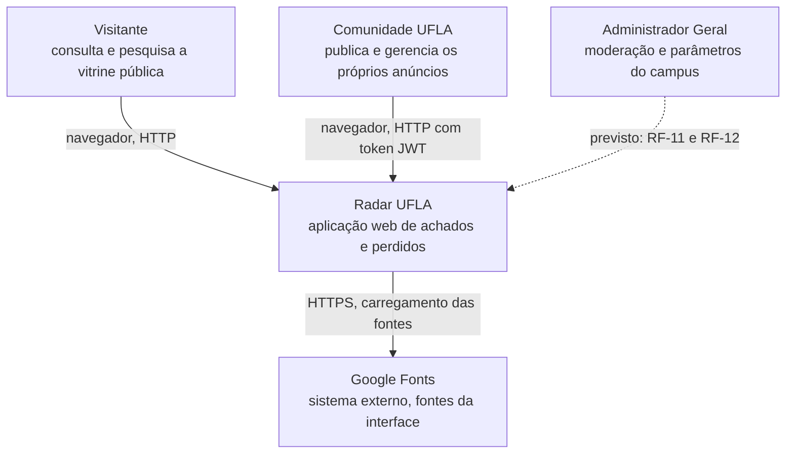
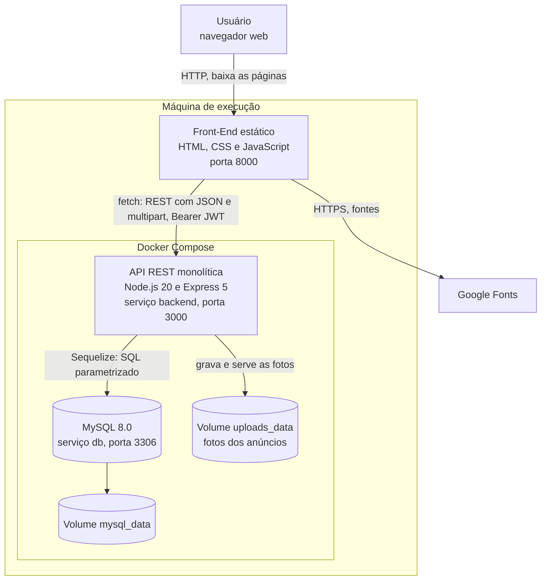
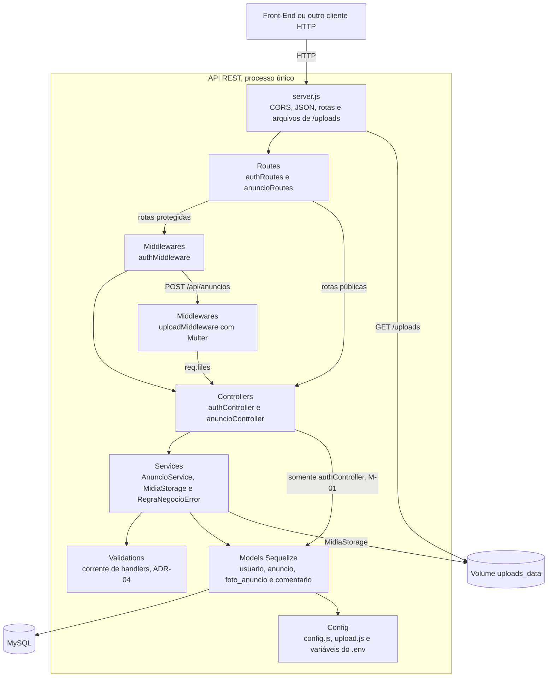
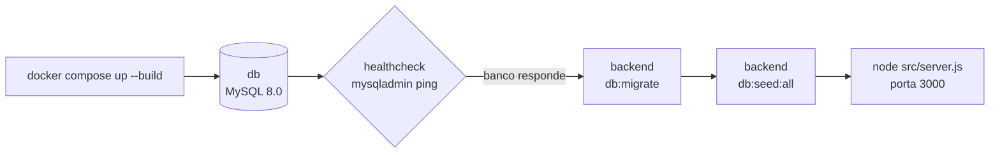

# Arquitetura — Radar UFLA

> Sprint 6 — Issue [#40](https://github.com/Matheus-Castro-Paula/Radar-UFLA/issues/40) | Responsável: Tech Lead (`@BernarDEVthomaz`)

Este documento apresenta a organização global do Radar UFLA: componentes, responsabilidades, comunicação entre as partes, tecnologias, relação com os requisitos não funcionais e forma de execução. As decisões arquiteturais estão registradas como ADR-05 a ADR-08 em [`decisoes-de-projeto.md`](../projeto/decisoes-de-projeto.md).

O documento corresponde ao código da `main` após as PRs [#46](https://github.com/Matheus-Castro-Paula/Radar-UFLA/pull/46), [#47](https://github.com/Matheus-Castro-Paula/Radar-UFLA/pull/47) e [#48](https://github.com/Matheus-Castro-Paula/Radar-UFLA/pull/48). Nos diagramas, os elementos tracejados representam funcionalidades previstas nos requisitos e ainda não implementadas. Os blocos são clicáveis e levam ao código correspondente; os mesmos destinos estão listados na seção 5.

## 1. Estilo arquitetural

O Radar UFLA adota uma arquitetura **cliente-servidor**, com o back-end organizado como um **monólito em camadas**:

- o **cliente** é um conjunto de páginas estáticas (HTML, CSS e JavaScript) executadas no navegador, que consomem a API por `fetch`;
- o **servidor** é uma única API REST em Node.js e Express, implantada como um único processo;
- os **dados** ficam em um banco relacional MySQL, e as fotos dos anúncios, em um volume local.

As alternativas avaliadas e a justificativa estão na ADR-05.

### 1.1 Arquitetura global, decisões locais e padrões

| Nível                    | Pergunta que responde                                  | No Radar UFLA                                                                 | Registro                                                                                          |
| ------------------------ | ------------------------------------------------------ | ----------------------------------------------------------------------------- | ------------------------------------------------------------------------------------------------- |
| Arquitetura global       | Quais partes existem e como se comunicam?              | Cliente-servidor, monólito em camadas, contêineres e armazenamento de mídia   | Este documento e ADR-05 a ADR-08                                                                  |
| Decisão local de projeto | Como organizar internamente um módulo?                 | Camada de serviços, autenticação com JWT e `RN-04` aplicada no service        | ADR-01 a ADR-03 em [`decisoes-de-projeto.md`](../projeto/decisoes-de-projeto.md)                  |
| Padrão de projeto        | Como resolver um problema recorrente em um trecho?     | Chain of Responsibility nas validações de anúncio                             | ADR-04 e [`padroes-de-projeto.md`](../padroes/padroes-de-projeto.md)                              |

## 2. Diagrama de Contexto

Mostra quem usa o sistema e com quais sistemas externos ele se relaciona.

Os três atores são os definidos em [`requisitos.md`](../requisitos/requisitos.md#2-atores-e-perfis). O papel de administrador já existe no cadastro de usuários, mas as telas de moderação e de parâmetros ainda não foram implementadas.

O Google Fonts é a única dependência externa ativa. O MySQL e o armazenamento de fotos são executados pelo próprio projeto, por isso aparecem como contêineres na seção 3, e não como sistemas externos. A ADR-08 registra a decisão de não usar um serviço externo de mídia. O envio de e-mail do `RF-13` ainda não foi implementado.

## 3. Diagrama de Contêineres

Mostra as unidades executáveis do sistema, as tecnologias e os protocolos entre elas.

O JavaScript do Front-End é executado no navegador, portanto as chamadas `fetch` partem da máquina do usuário. Como o Front-End (porta 8000) e a API (porta 3000) têm origens diferentes, a API habilita CORS em [`server.js`](../../API/Back-End/src/server.js). As fotos gravadas são servidas pela própria API em `/uploads/<arquivo>`, e o Front-End monta o endereço a partir da origem da API. O Front-End não faz parte do Compose (ADR-07).

## 4. Componentes da API

Detalha o contêiner da API e a separação em camadas.

Cada camada conversa com a camada imediatamente abaixo. O `uploadMiddleware` só é aplicado ao `POST /api/anuncios`, depois da autenticação. A exceção conhecida é o `authController`, que ainda acessa o model `Usuario` diretamente (melhoria M-01). O que cada camada faz e o que não deve fazer está na seção 1 de [`decisoes-de-projeto.md`](../projeto/decisoes-de-projeto.md).

## 5. Responsabilidades e interfaces

### 5.1 Contêineres

| Componente             | Responsabilidade                                                                                                        | Interface                                                                | Código                                                                                                                                                                  |
| ---------------------- | ----------------------------------------------------------------------------------------------------------------------- | ------------------------------------------------------------------------ | ----------------------------------------------------------------------------------------------------------------------------------------------------------------------- |
| Front-End estático     | Exibir a vitrine e os formulários, aplicar busca e filtros sobre os anúncios carregados e guardar o token no navegador. | Páginas servidas na porta 8000; consome a API por `fetch`.               | [`API/Front-End/`](../../API/Front-End/)                                                                                                                                |
| API REST               | Autenticar usuários, aplicar as regras de negócio, validar os dados recebidos e servir as fotos.                        | HTTP na porta 3000, conforme a seção 5.3.                                | [`API/Back-End/src/`](../../API/Back-End/src/)                                                                                                                          |
| MySQL                  | Persistir usuários, anúncios, fotos e comentários.                                                                      | Protocolo MySQL em `db:3306`, acessado somente pelos models.             | [`docker-compose.yml`](../../API/Back-End/docker-compose.yml), [`src/models/`](../../API/Back-End/src/models/), [`src/migrations/`](../../API/Back-End/src/migrations/) |
| Volume `mysql_data`    | Manter os dados do banco entre reinícios do contêiner.                                                                  | Volume nomeado do Docker, montado em `/var/lib/mysql`.                   | [`docker-compose.yml`](../../API/Back-End/docker-compose.yml)                                                                                                           |
| Volume `uploads_data`  | Guardar os arquivos das fotos dos anúncios.                                                                             | Montado em `/app/uploads`; gravado pela API e lido por HTTP em `/uploads/<arquivo>`. | [`docker-compose.yml`](../../API/Back-End/docker-compose.yml), [`MidiaStorage.js`](../../API/Back-End/src/services/MidiaStorage.js), [`config/upload.js`](../../API/Back-End/src/config/upload.js) |
| Google Fonts           | Fornecer as fontes Fraunces e Inter.                                                                                    | CSS carregado pelo navegador por HTTPS.                                  | [`index.html`](../../API/Front-End/index.html)                                                                                                                          |

### 5.2 Camadas da API

| Origem      | Destino        | Interface                                                                                                         | Código                                                                                                                                                                                       |
| ----------- | -------------- | ----------------------------------------------------------------------------------------------------------------- | -------------------------------------------------------------------------------------------------------------------------------------------------------------------------------------------- |
| Cliente     | `server.js`    | Requisições HTTP; CORS, leitura de JSON e arquivos estáticos de `/uploads` são aplicados globalmente.             | [`app.js`](../../API/Front-End/app.js), [`server.js`](../../API/Back-End/src/server.js)                                                                                                      |
| `server.js` | Routes         | Prefixos `/api/auth` e `/api/anuncios`.                                                                           | [`routes/`](../../API/Back-End/src/routes/)                                                                                                                                                  |
| Routes      | Middlewares    | Função Express `(req, res, next)`: `authMiddleware` nas rotas protegidas e `uploadMiddleware` no `POST /api/anuncios`. | [`anuncioRoutes.js`](../../API/Back-End/src/routes/anuncioRoutes.js), [`middlewares/`](../../API/Back-End/src/middlewares/)                                                              |
| Middlewares | Controllers    | `req.usuarioId` e `req.usuarioTipo`, extraídos do JWT, e `req.files`, com as fotos em memória.                    | [`authMiddleware.js`](../../API/Back-End/src/middlewares/authMiddleware.js), [`uploadMiddleware.js`](../../API/Back-End/src/middlewares/uploadMiddleware.js)                                 |
| Controllers | Services       | Métodos como `AnuncioService.criar(dados, usuarioId, arquivos)`; falhas de regra chegam como `RegraNegocioError`. | [`controllers/`](../../API/Back-End/src/controllers/), [`services/`](../../API/Back-End/src/services/)                                                                                       |
| Services    | Validations    | `anuncioValidationChain.executar(dados, { acao, arquivos })`.                                                     | [`services/validations/`](../../API/Back-End/src/services/validations/)                                                                                                                      |
| Services    | `MidiaStorage` | `salvar(arquivos)` grava em `/uploads` e devolve os caminhos; `remover(urls)` desfaz a gravação se o banco falhar. | [`MidiaStorage.js`](../../API/Back-End/src/services/MidiaStorage.js)                                                                                                                         |
| Services    | Models         | Consultas e transações do Sequelize.                                                                              | [`AnuncioService.js`](../../API/Back-End/src/services/AnuncioService.js), [`models/`](../../API/Back-End/src/models/)                                                                        |
| Models      | MySQL          | Sequelize com o driver `mysql2`, configurado por `config.js` e pelas variáveis do `.env`.                         | [`models/index.js`](../../API/Back-End/src/models/index.js), [`config.js`](../../API/Back-End/src/config/config.js), [`.env.example`](../../API/Back-End/.env.example)                       |

### 5.3 Convenções da API REST

| Aspecto               | Convenção                                                                                                                              |
| --------------------- | -------------------------------------------------------------------------------------------------------------------------------------- |
| Rotas                 | `/api/auth/*` e `/api/anuncios`, listadas na [seção 11 do README](../../README.md#11-endpoints-da-api).                                 |
| Formato               | JSON. A criação de anúncio aceita `multipart/form-data`, com as fotos no campo `fotos` (seção 5.4).                                    |
| Autenticação          | Cabeçalho `Authorization: Bearer <token>`, com JWT válido por 24 horas e assinado com o `JWT_SECRET` do `.env` (ADR-02).               |
| Leitura pública       | `GET /api/anuncios` e `GET /api/anuncios/:id` não exigem token e expõem do autor apenas `id` e `nome` (`RN-04`).                        |
| Arquivos              | `GET /uploads/<arquivo>` é público e responde com `X-Content-Type-Options: nosniff`.                                                   |
| Falha de autenticação | `401` quando o token está ausente, tem formato inválido ou expirou.                                                                    |
| Erros de regra        | `VALIDACAO` e `LGPD` respondem `400`, `PROIBIDO` responde `403` e `NAO_ENCONTRADO` responde `404`. Envio acima dos limites de upload responde `400`. |
| Erros inesperados     | `500` com mensagem genérica; o detalhe do erro vai apenas para o log do servidor (melhoria M-06).                                      |

### 5.4 Fluxo do upload de fotos

Implementado nas PRs [#46](https://github.com/Matheus-Castro-Paula/Radar-UFLA/pull/46), [#47](https://github.com/Matheus-Castro-Paula/Radar-UFLA/pull/47) e [#48](https://github.com/Matheus-Castro-Paula/Radar-UFLA/pull/48), conforme a ADR-08. A coluna **Situação** indica onde o código diverge do contrato combinado no início da sprint.

| Etapa              | Como funciona                                                                                                                                                                 | Código                                                                                                                                                                                         | Situação                                                                                                   |
| ------------------ | ----------------------------------------------------------------------------------------------------------------------------------------------------------------------------- | ---------------------------------------------------------------------------------------------------------------------------------------------------------------------------------------------- | ---------------------------------------------------------------------------------------------------------- |
| Envio              | O Front-End envia `POST /api/anuncios` em `multipart/form-data`, com os campos de texto, `data_ocorrencia` em ISO com fuso e até 3 arquivos no campo `fotos`. Antes de enviar, confere tipo e tamanho e retira as fotos da categoria `documento`. | [`publicar.html`](../../API/Front-End/publicar.html), [`app.js`](../../API/Front-End/app.js)                                                                                                   | Implementado (#48)                                                                                         |
| Recebimento        | O `uploadMiddleware` usa Multer em memória, com limite de 5 MB por arquivo e 3 arquivos por requisição.                                                                       | [`uploadMiddleware.js`](../../API/Back-End/src/middlewares/uploadMiddleware.js), [`config/upload.js`](../../API/Back-End/src/config/upload.js)                                                 | Implementado (#47)                                                                                         |
| Entrada no service | O controller repassa `req.files` como `arquivos`, separados dos campos de texto. O `PUT` continua em JSON, com a lista de caminhos já salvos.                                 | [`anuncioController.js`](../../API/Back-End/src/controllers/anuncioController.js)                                                                                                              | Implementado (#47). O `POST` ainda aceita URLs em JSON e as junta às fotos gravadas (M-16).                |
| Validação          | O `FotosHandler` confere a quantidade total, o MIME, o tamanho e os bytes iniciais de cada arquivo. O `RegraLGPDHandler` também considera os arquivos, então a `RN-04` vale para o envio em multipart. | [`FotosHandler.js`](../../API/Back-End/src/services/validations/FotosHandler.js), [`RegraLGPDHandler.js`](../../API/Back-End/src/services/validations/RegraLGPDHandler.js)                     | Implementado (#47)                                                                                         |
| Gravação           | Depois da aprovação da corrente, o `MidiaStorage` grava os arquivos com nome gerado (UUID), e o caminho relativo vai para `foto_anuncio.url_imagem`. Se a transação falhar, os arquivos são removidos. | [`MidiaStorage.js`](../../API/Back-End/src/services/MidiaStorage.js), [`AnuncioService.js`](../../API/Back-End/src/services/AnuncioService.js)                                                | Implementado (#47). `mime_type` e `tamanho_bytes` ainda não são preenchidos (M-18).                        |
| Armazenamento      | A pasta `/app/uploads` fica no volume `uploads_data`, que persiste entre reinícios.                                                                                          | [`docker-compose.yml`](../../API/Back-End/docker-compose.yml)                                                                                                                                  | Implementado (#46)                                                                                         |
| Leitura            | O Express serve a pasta em `/uploads`. O Front-End monta o endereço com a origem da API, aceita apenas caminhos de `/uploads/` ou endereços http(s) e nunca mostra foto de documento. | [`server.js`](../../API/Back-End/src/server.js), [`app.js`](../../API/Front-End/app.js)                                                                                                        | Implementado (#47 e #48)                                                                                   |
| Data da ocorrência | A coluna `data_ocorrencia` existe, e o Front-End a envia em todo cadastro.                                                                                                    | [`add-data-ocorrencia-to-anuncio.js`](../../API/Back-End/src/migrations/20261109000000-add-data-ocorrencia-to-anuncio.js), [`models/anuncio.js`](../../API/Back-End/src/models/anuncio.js)     | **Pendente.** O `AnuncioService` não grava o campo, e a vitrine exibe a data de criação (M-15).            |

## 6. Tecnologias

A stack foi definida como restrição do projeto na Sprint 1 ([`visao-geral.md`](../visao-geral.md#5-restrições-e-premissas), seção 5). A tabela relaciona cada tecnologia à necessidade que ela atende nesta arquitetura.

| Tecnologia                     | Papel na arquitetura                          | Justificativa                                                                                                                                                       |
| ------------------------------ | --------------------------------------------- | ------------------------------------------------------------------------------------------------------------------------------------------------------------------- |
| Node.js 20                     | Ambiente de execução da API                   | A API passa a maior parte do tempo aguardando banco e arquivos, perfil adequado ao modelo de I/O assíncrono. A mesma linguagem do Front-End facilita a atuação da equipe nas duas partes. |
| Express 5                      | Servidor HTTP e cadeia de middlewares         | O modelo de middlewares corresponde à separação adotada: autenticação e upload ficam antes do controller, sem se misturar às regras de negócio.                      |
| Sequelize 6 e `mysql2`         | Acesso a dados, associações e migrations      | Consultas parametrizadas reduzem o risco de injeção de SQL (`RNF-03`), transações garantem a gravação conjunta de anúncio e fotos, e migrations versionam o esquema (ADR-06). |
| MySQL 8.0                      | Banco de dados relacional                     | Usuários, anúncios, fotos e comentários formam relacionamentos 1:N com integridade referencial, conforme o `RNF-06`.                                                 |
| `jsonwebtoken` e `bcryptjs`    | Autenticação e armazenamento de senhas        | Token sem estado no servidor, adequado a um cliente separado da API, e senhas guardadas apenas em hash (ADR-02 e `RNF-03`).                                          |
| Multer                         | Recebimento de `multipart/form-data`          | Integra-se ao Express como middleware, mantém os arquivos em memória e aplica limites de tamanho e quantidade antes do controller (`RF-08` e ADR-08).                 |
| Docker e Docker Compose        | Empacotamento e execução da API e do banco    | Mesma versão de Node.js e MySQL em todas as máquinas e isolamento dos serviços (`RNF-06` e ADR-07).                                                                  |
| HTML, CSS e JavaScript         | Interface do usuário                          | Páginas estáticas dispensam etapa de build e evitam o carregamento de um framework no navegador (`RNF-02`).                                                          |

## 7. Requisitos não funcionais e decisões arquiteturais

A coluna **Situação** indica o que pode ser verificado na `main` ao fim da sprint. O que ainda não é atendido gera as melhorias listadas na seção 9.

| Requisito                             | Decisões arquiteturais                                                                                                                                                                                                                  | Evidência                                                                                                                                                                                                                                                                                                                                                                       | Situação                                                                                                                                                                                                       |
| ------------------------------------- | --------------------------------------------------------------------------------------------------------------------------------------------------------------------------------------------------------------------------------------- | ------------------------------------------------------------------------------------------------------------------------------------------------------------------------------------------------------------------------------------------------------------------------------------------------------------------------------------------------------------------------------- | -------------------------------------------------------------------------------------------------------------------------------------------------------------------------------------------------------------- |
| `RNF-01` Usabilidade                  | Interface separada da API, com CSS próprio.                                                                                                                                                                                             | [`styles.css`](../../API/Front-End/styles.css), com ponto de quebra em 720 px.                                                                                                                                                                                                                                                                                                  | **Parcial.** O layout é responsivo, mas o CSS parte do desktop, e não de mobile-first.                                                                                                                         |
| `RNF-02` Desempenho                   | Busca e filtros aplicados no navegador sobre a lista já carregada; índice por `tipo` e `status`; Front-End sem framework.                                                                                                               | Função `render` em [`app.js`](../../API/Front-End/app.js) e `idx_anuncio_tipo_status` em [`create-anuncios`](../../API/Back-End/src/migrations/20260918000001-create-anuncios.js).                                                                                                                                                                                               | **Não medido.** As metas de 800 ms e 2 s serão verificadas na Sprint 7. A listagem ainda não é paginada (M-12).                                                                                                |
| `RNF-03` Segurança                    | Senhas com bcrypt e JWT sem estado, com segredo obrigatório no `.env` (ADR-02); SQL parametrizado (ADR-06); `RN-04` validada na API e vitrine sem dados pessoais (ADR-03); fotos validadas por tipo, tamanho e conteúdo (ADR-08); conteúdo escapado no Front-End. | [`config.js`](../../API/Back-End/src/config/config.js), [`authController.js`](../../API/Back-End/src/controllers/authController.js), [`RegraLGPDHandler.js`](../../API/Back-End/src/services/validations/RegraLGPDHandler.js), [`FotosHandler.js`](../../API/Back-End/src/services/validations/FotosHandler.js), `INCLUDE_PUBLICO` em [`AnuncioService.js`](../../API/Back-End/src/services/AnuncioService.js) e `escapeHTML` em [`app.js`](../../API/Front-End/app.js). | **Parcial.** A API responde em HTTP, sem TLS (M-08), o CORS aceita qualquer origem (M-10), o cadastro ainda aceita URLs externas como foto (M-16) e a senha do banco fica no Compose (M-11).                  |
| `RNF-04` Auditoria e Confiabilidade   | Transações do Sequelize na gravação de anúncios; reinício automático dos contêineres; API iniciada só depois que o banco responde ao healthcheck.                                                                                       | `sequelize.transaction` em [`AnuncioService.js`](../../API/Back-End/src/services/AnuncioService.js); `restart`, `healthcheck` e `depends_on` em [`docker-compose.yml`](../../API/Back-End/docker-compose.yml).                                                                                                                                                                    | **Não atendido.** Não há log de auditoria (M-09), a instância única não sustenta a meta de 99,5%, que também não é medida, e o seeder impede a subida em bancos anteriores à Sprint 6 (M-17).                  |
| `RNF-05` Acessibilidade               | Atributos ARIA nos componentes dinâmicos da interface.                                                                                                                                                                                  | `role="tablist"`, `aria-selected` e `aria-live` em [`index.html`](../../API/Front-End/index.html).                                                                                                                                                                                                                                                                               | **Parcial.** A conformidade com a WCAG 2.1 AA ainda não foi validada com Axe ou WAVE.                                                                                                                          |
| `RNF-06` Arquitetura                  | Cliente-servidor com monólito em camadas (ADR-05), banco relacional (ADR-06), serviços isolados no Docker (ADR-07) e fotos em volume local (ADR-08).                                                                                     | Seções 3, 4 e 5.4 deste documento e [`docker-compose.yml`](../../API/Back-End/docker-compose.yml).                                                                                                                                                                                                                                                                               | **Atendido.** O armazenamento de mídias entrou na Sprint 6, em volume persistente e com validação antes da gravação.                                                                                           |

## 8. Implantação e execução

Esta seção descreve o ambiente usado no desenvolvimento e na demonstração, configurado na PR [#46](https://github.com/Matheus-Castro-Paula/Radar-UFLA/pull/46) (evidências em [`sprint-06-docker-migrations.txt`](../sprints/evidencias/sprint-06-docker-migrations.txt)).

| Unidade     | Origem                                                                                                    | Porta | Persistência                                                                 | Configuração                                                                                                                   |
| ----------- | --------------------------------------------------------------------------------------------------------- | ----- | ---------------------------------------------------------------------------- | ------------------------------------------------------------------------------------------------------------------------------ |
| `db`        | Imagem `mysql:8.0`, com healthcheck a cada 5 s                                                            | 3306  | Volume `mysql_data`                                                          | `MYSQL_ROOT_PASSWORD` e `MYSQL_DATABASE` no [`docker-compose.yml`](../../API/Back-End/docker-compose.yml)                      |
| `backend`   | [`Dockerfile`](../../API/Back-End/Dockerfile) com `node:20-alpine`, iniciado por [`docker-entrypoint.sh`](../../API/Back-End/docker-entrypoint.sh) | 3000  | Código montado em `/app`; fotos no volume `uploads_data`, em `/app/uploads` | Arquivo `.env`, a partir de [`.env.example`](../../API/Back-End/.env.example); o Compose fixa `DB_HOST` e `DB_PASSWORD`       |
| Front-End   | Arquivos de [`API/Front-End`](../../API/Front-End/), servidos fora do Compose com `python -m http.server`  | 8000  | Não se aplica                                                                | Constante `API_BASE` em [`app.js`](../../API/Front-End/app.js)                                                                 |

Ordem de inicialização:

1. Copiar `.env.example` para `.env` e preencher `JWT_SECRET`. A variável é obrigatória: sem ela, a API não sobe.
2. Executar `docker compose up --build` em `API/Back-End`. O serviço `backend` só inicia depois que o `db` responde ao healthcheck.
3. O `docker-entrypoint.sh` aplica as migrations e os seeders e só então inicia a API. Os seeders aplicados ficam registrados no banco, então não rodam de novo nas próximas subidas.
4. Servir o Front-End na porta 8000 e acessar `http://localhost:8000`.

Depois de uma dependência nova no `package.json`, como o Multer, é preciso subir com `docker compose up --build -V`. Sem o `-V`, o Compose reaproveita a pasta `node_modules` do contêiner anterior. A seção 10 do [README](../../README.md#10-execução-da-aplicação) ainda descreve a aplicação manual de migrations, anterior a esta configuração.

Limites deste ambiente:

- a API responde em HTTP e há uma única instância de cada serviço, o que atende à demonstração acadêmica, mas não a um ambiente de produção;
- o Compose repete a senha do banco em três pontos (`MYSQL_ROOT_PASSWORD`, healthcheck e variáveis do `backend`) e expõe a porta do MySQL na máquina (M-11);
- em bancos criados antes da Sprint 6, o seeder tenta recriar o usuário de demonstração, o e-mail único falha e a API não sobe; até a correção (M-17), é preciso recriar o volume com `docker compose down -v`;
- cada banco novo recebe o administrador de demonstração, com senha conhecida, adequado apenas ao uso local;
- até esta sprint, não há versão publicada da aplicação.

## 9. Débitos e ajustes arquiteturais

Identificados ao confrontar esta arquitetura com o código. Motivos e prioridades estão na seção 4 de [`decisoes-de-projeto.md`](../projeto/decisoes-de-projeto.md).

| ID   | Ajuste                                                                     | Situação                                                                                |
| ---- | -------------------------------------------------------------------------- | --------------------------------------------------------------------------------------- |
| M-01 | Extrair um `AuthService`, para o `authController` deixar de acessar models | A fazer                                                                                 |
| M-02 | Tornar `JWT_SECRET` obrigatório via `.env`, sem valor padrão               | Resolvida na PR [#47](https://github.com/Matheus-Castro-Paula/Radar-UFLA/pull/47)       |
| M-04 | Validar o limite de 5 MB por arquivo                                       | Resolvida na PR [#47](https://github.com/Matheus-Castro-Paula/Radar-UFLA/pull/47)       |
| M-06 | Remover detalhes internos das respostas de erro 500                        | Resolvida na PR [#47](https://github.com/Matheus-Castro-Paula/Radar-UFLA/pull/47)       |
| M-08 | Publicar a API com HTTPS/TLS                                               | A fazer                                                                                 |
| M-09 | Registrar log de auditoria                                                 | A fazer                                                                                 |
| M-10 | Restringir o CORS e ler a porta do `.env`                                  | A fazer                                                                                 |
| M-11 | Retirar a senha do Compose e não expor a porta do MySQL                    | A fazer                                                                                 |
| M-12 | Paginar a listagem e levar busca e filtros ao servidor                     | A fazer                                                                                 |
| M-13 | Apagar os arquivos ao excluir ou substituir fotos                          | A fazer                                                                                 |
| M-14 | Conferir a assinatura real dos arquivos enviados                           | Resolvida na PR [#47](https://github.com/Matheus-Castro-Paula/Radar-UFLA/pull/47)       |
| M-15 | Gravar `data_ocorrencia` na criação e na edição de anúncios                | A fazer                                                                                 |
| M-16 | Aceitar como foto só arquivos enviados e caminhos de `/uploads/`           | A fazer                                                                                 |
| M-17 | Tornar o seeder de demonstração idempotente                                | A fazer                                                                                 |
| M-18 | Gravar `mime_type` e `tamanho_bytes` das fotos                             | A fazer                                                                                 |
