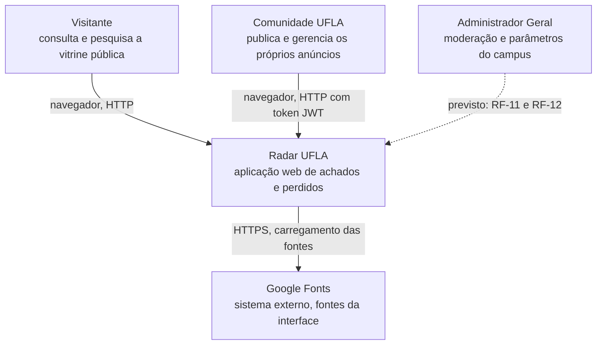
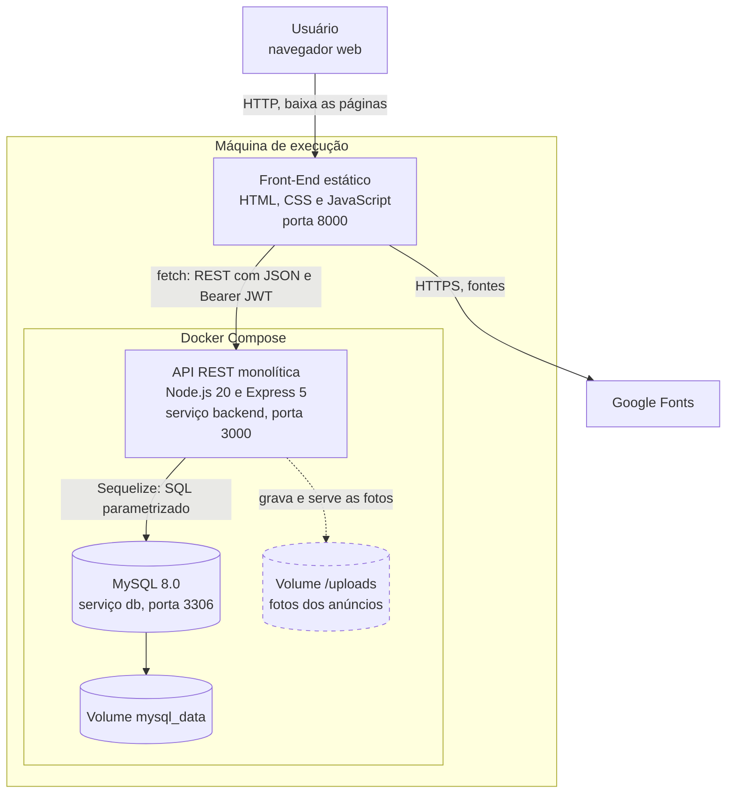
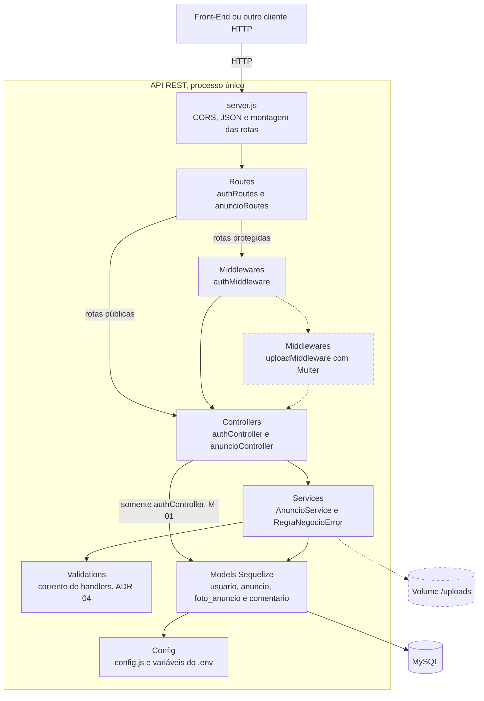

# Arquitetura — Radar UFLA

> Sprint 6 — Issue [#40](https://github.com/Matheus-Castro-Paula/Radar-UFLA/issues/40) | Responsável: Tech Lead (`@BernarDEVthomaz`)

Este documento apresenta a organização global do Radar UFLA: componentes, responsabilidades, comunicação entre as partes, tecnologias, relação com os requisitos não funcionais e forma de execução. As decisões arquiteturais estão registradas como ADR-05 a ADR-08 em [`decisoes-de-projeto.md`](../projeto/decisoes-de-projeto.md).

Nos diagramas, os elementos tracejados ainda não fazem parte da `main`: estão em implementação nas Issues [#41](https://github.com/Matheus-Castro-Paula/Radar-UFLA/issues/41), [#42](https://github.com/Matheus-Castro-Paula/Radar-UFLA/issues/42) e [#43](https://github.com/Matheus-Castro-Paula/Radar-UFLA/issues/43) ou previstos nos requisitos. Os blocos são clicáveis e levam ao código correspondente; os mesmos destinos estão listados na seção 5.

## 1. Estilo arquitetural

O Radar UFLA adota uma arquitetura **cliente-servidor**, com o back-end organizado como um **monólito em camadas**:

- o **cliente** é um conjunto de páginas estáticas (HTML, CSS e JavaScript) executadas no navegador, que consomem a API por `fetch`;
- o **servidor** é uma única API REST em Node.js e Express, implantada como um único processo;
- os **dados** ficam em um banco relacional MySQL, e as fotos dos anúncios, em um volume local.

As alternativas avaliadas e a justificativa estão na ADR-05.

### 1.1 Arquitetura global, decisões locais e padrões

| Nível                    | Pergunta que responde                                  | No Radar UFLA                                                                 | Registro                                                                                          |
| ------------------------ | ------------------------------------------------------ | ----------------------------------------------------------------------------- | ------------------------------------------------------------------------------------------------- |
| Arquitetura global       | Quais partes existem e como se comunicam?              | Cliente-servidor, monólito em camadas, contêineres e armazenamento de mídia   | Este documento e ADR-05 a ADR-08                                                                  |
| Decisão local de projeto | Como organizar internamente um módulo?                 | Camada de serviços, autenticação com JWT e `RN-04` aplicada no service        | ADR-01 a ADR-03 em [`decisoes-de-projeto.md`](../projeto/decisoes-de-projeto.md)                  |
| Padrão de projeto        | Como resolver um problema recorrente em um trecho?     | Chain of Responsibility nas validações de anúncio                             | ADR-04 e [`padroes-de-projeto.md`](../padroes/padroes-de-projeto.md)                              |

## 2. Diagrama de Contexto

Mostra quem usa o sistema e com quais sistemas externos ele se relaciona.

Os três atores são os definidos em [`requisitos.md`](../requisitos/requisitos.md#2-atores-e-perfis). O papel de administrador já existe no cadastro de usuários, mas as telas de moderação e de parâmetros ainda não foram implementadas.

O Google Fonts é a única dependência externa ativa. O MySQL e o armazenamento de fotos são executados pelo próprio projeto, por isso aparecem como contêineres na seção 3, e não como sistemas externos. A ADR-08 registra a decisão de não usar um serviço externo de mídia. O envio de e-mail do `RF-13` ainda não foi implementado.

## 3. Diagrama de Contêineres

Mostra as unidades executáveis do sistema, as tecnologias e os protocolos entre elas.

O JavaScript do Front-End é executado no navegador, portanto as chamadas `fetch` partem da máquina do usuário. Como o Front-End (porta 8000) e a API (porta 3000) têm origens diferentes, a API habilita CORS em [`server.js`](../../API/Back-End/src/server.js). O Front-End não faz parte do Compose (ADR-07).

## 4. Componentes da API

Detalha o contêiner da API e a separação em camadas.

Cada camada conversa com a camada imediatamente abaixo. A exceção conhecida é o `authController`, que ainda acessa o model `Usuario` diretamente (melhoria M-01). O que cada camada faz e o que não deve fazer está na seção 1 de [`decisoes-de-projeto.md`](../projeto/decisoes-de-projeto.md).

## 5. Responsabilidades e interfaces

### 5.1 Contêineres

| Componente                        | Responsabilidade                                                                                     | Interface                                                                    | Código                                                                                                                                                        |
| --------------------------------- | ---------------------------------------------------------------------------------------------------- | ---------------------------------------------------------------------------- | ------------------------------------------------------------------------------------------------------------------------------------------------------------- |
| Front-End estático                | Exibir a vitrine e os formulários, aplicar busca e filtros sobre os anúncios carregados e guardar o token no navegador. | Páginas servidas na porta 8000; consome a API por `fetch`.                   | [`API/Front-End/`](../../API/Front-End/)                                                                                                                      |
| API REST                          | Autenticar usuários, aplicar as regras de negócio e validar os dados recebidos.                      | HTTP na porta 3000, conforme a seção 5.3.                                    | [`API/Back-End/src/`](../../API/Back-End/src/)                                                                                                                |
| MySQL                             | Persistir usuários, anúncios, fotos e comentários.                                                   | Protocolo MySQL em `db:3306`, acessado somente pelos models.                 | [`docker-compose.yml`](../../API/Back-End/docker-compose.yml), [`src/models/`](../../API/Back-End/src/models/), [`src/migrations/`](../../API/Back-End/src/migrations/) |
| Volume `mysql_data`               | Manter os dados do banco entre reinícios do contêiner.                                               | Volume nomeado do Docker, montado em `/var/lib/mysql`.                       | [`docker-compose.yml`](../../API/Back-End/docker-compose.yml)                                                                                                 |
| Volume `/uploads` (em implementação) | Guardar os arquivos das fotos dos anúncios.                                                       | Escrita pela API e leitura por HTTP em `/uploads/<arquivo>` (seção 5.4).     | [`docker-compose.yml`](../../API/Back-End/docker-compose.yml)                                                                                                 |
| Google Fonts                      | Fornecer as fontes Fraunces e Inter.                                                                 | CSS carregado pelo navegador por HTTPS.                                      | [`index.html`](../../API/Front-End/index.html)                                                                                                                |

### 5.2 Camadas da API

| Origem      | Destino     | Interface                                                                                                  | Código                                                                                                                                                 |
| ----------- | ----------- | ---------------------------------------------------------------------------------------------------------- | ------------------------------------------------------------------------------------------------------------------------------------------------------ |
| Cliente     | `server.js` | Requisições HTTP; CORS e leitura de JSON são aplicados globalmente.                                        | [`app.js`](../../API/Front-End/app.js), [`server.js`](../../API/Back-End/src/server.js)                                                                |
| `server.js` | Routes      | Prefixos `/api/auth` e `/api/anuncios`.                                                                    | [`routes/`](../../API/Back-End/src/routes/)                                                                                                            |
| Routes      | Middlewares | Função Express `(req, res, next)` aplicada às rotas protegidas.                                            | [`anuncioRoutes.js`](../../API/Back-End/src/routes/anuncioRoutes.js), [`middlewares/`](../../API/Back-End/src/middlewares/)                            |
| Middlewares | Controllers | `req.usuarioId` e `req.usuarioTipo`, extraídos do JWT.                                                     | [`authMiddleware.js`](../../API/Back-End/src/middlewares/authMiddleware.js), [`controllers/`](../../API/Back-End/src/controllers/)                     |
| Controllers | Services    | Métodos como `AnuncioService.criar(dados, usuarioId)`; falhas de regra chegam como `RegraNegocioError`.    | [`services/`](../../API/Back-End/src/services/)                                                                                                        |
| Services    | Validations | `anuncioValidationChain.executar(dados, { acao })`.                                                        | [`services/validations/`](../../API/Back-End/src/services/validations/)                                                                                |
| Services    | Models      | Consultas e transações do Sequelize.                                                                       | [`AnuncioService.js`](../../API/Back-End/src/services/AnuncioService.js), [`models/`](../../API/Back-End/src/models/)                                  |
| Models      | MySQL       | Sequelize com o driver `mysql2`, configurado por `config.js` e pelas variáveis do `.env`.                  | [`models/index.js`](../../API/Back-End/src/models/index.js), [`config.js`](../../API/Back-End/src/config/config.js), [`.env.example`](../../API/Back-End/.env.example) |

### 5.3 Convenções da API REST

| Aspecto               | Convenção                                                                                                                                                                                  |
| --------------------- | ------------------------------------------------------------------------------------------------------------------------------------------------------------------------------------------ |
| Rotas                 | `/api/auth/*` e `/api/anuncios`, listadas na [seção 11 do README](../../README.md#11-endpoints-da-api).                                                                                     |
| Formato               | JSON. A criação de anúncio passa a usar `multipart/form-data` com a Issue [#41](https://github.com/Matheus-Castro-Paula/Radar-UFLA/issues/41) (seção 5.4).                                   |
| Autenticação          | Cabeçalho `Authorization: Bearer <token>`, com JWT válido por 24 horas (ADR-02).                                                                                                           |
| Leitura pública       | `GET /api/anuncios` e `GET /api/anuncios/:id` não exigem token e expõem do autor apenas `id` e `nome` (`RN-04`).                                                                            |
| Falha de autenticação | `401` quando o token está ausente, tem formato inválido ou expirou.                                                                                                                        |
| Erros de regra        | `VALIDACAO` e `LGPD` respondem `400`, `PROIBIDO` responde `403` e `NAO_ENCONTRADO` responde `404`.                                                                                         |
| Erros inesperados     | `500`. A remoção de `details` dessas respostas está na Issue [#41](https://github.com/Matheus-Castro-Paula/Radar-UFLA/issues/41) (melhoria M-06).                                            |

### 5.4 Contrato do upload de fotos

Contrato definido nesta sprint para integrar as Issues [#41](https://github.com/Matheus-Castro-Paula/Radar-UFLA/issues/41), [#42](https://github.com/Matheus-Castro-Paula/Radar-UFLA/issues/42) e [#43](https://github.com/Matheus-Castro-Paula/Radar-UFLA/issues/43), conforme a ADR-08. Até a conclusão dessas Issues, as fotos continuam representadas como lista de URLs.

| Etapa              | Contrato                                                                                                                                                                                             | Issue                                                                                                                                              |
| ------------------ | ---------------------------------------------------------------------------------------------------------------------------------------------------------------------------------------------------- | -------------------------------------------------------------------------------------------------------------------------------------------------- |
| Envio              | O Front-End envia `POST /api/anuncios` em `multipart/form-data`, com os campos de texto atuais, `data_ocorrencia` e até 3 arquivos no campo `fotos`.                                                  | [#43](https://github.com/Matheus-Castro-Paula/Radar-UFLA/issues/43)                                                                                |
| Recebimento        | O `uploadMiddleware` usa Multer em memória (`memoryStorage`), com limite de 5 MB por arquivo e 3 arquivos por requisição.                                                                             | [#41](https://github.com/Matheus-Castro-Paula/Radar-UFLA/issues/41)                                                                                |
| Entrada no service | O controller repassa `req.files` em `dados.fotos`. O `PUT` continua em JSON, com a lista de caminhos já salvos.                                                                                       | [#41](https://github.com/Matheus-Castro-Paula/Radar-UFLA/issues/41)                                                                                |
| Validação          | O `FotosHandler` confere quantidade, tamanho e MIME dos arquivos novos e a extensão dos caminhos já salvos. O `RegraLGPDHandler` continua lendo `dados.fotos`, portanto a `RN-04` vale sem alteração. | [#41](https://github.com/Matheus-Castro-Paula/Radar-UFLA/issues/41)                                                                                |
| Gravação           | Depois da aprovação da corrente, o `AnuncioService` grava os arquivos em `/uploads` com nome gerado e salva o caminho relativo em `foto_anuncio.url_imagem`. Se a transação falhar, remove os arquivos gravados. | [#41](https://github.com/Matheus-Castro-Paula/Radar-UFLA/issues/41), [#42](https://github.com/Matheus-Castro-Paula/Radar-UFLA/issues/42)           |
| Leitura            | O Express serve a pasta em `/uploads`. O Front-End monta o endereço com a origem da API, sem o sufixo `/api`, e usa um placeholder quando não há foto.                                                | [#41](https://github.com/Matheus-Castro-Paula/Radar-UFLA/issues/41), [#43](https://github.com/Matheus-Castro-Paula/Radar-UFLA/issues/43)           |
| Data da ocorrência | A coluna `data_ocorrencia` é gravada pelo `AnuncioService` em `criar` e incluída nos campos editáveis de `atualizar`.                                                                                 | [#41](https://github.com/Matheus-Castro-Paula/Radar-UFLA/issues/41), [#42](https://github.com/Matheus-Castro-Paula/Radar-UFLA/issues/42)           |
