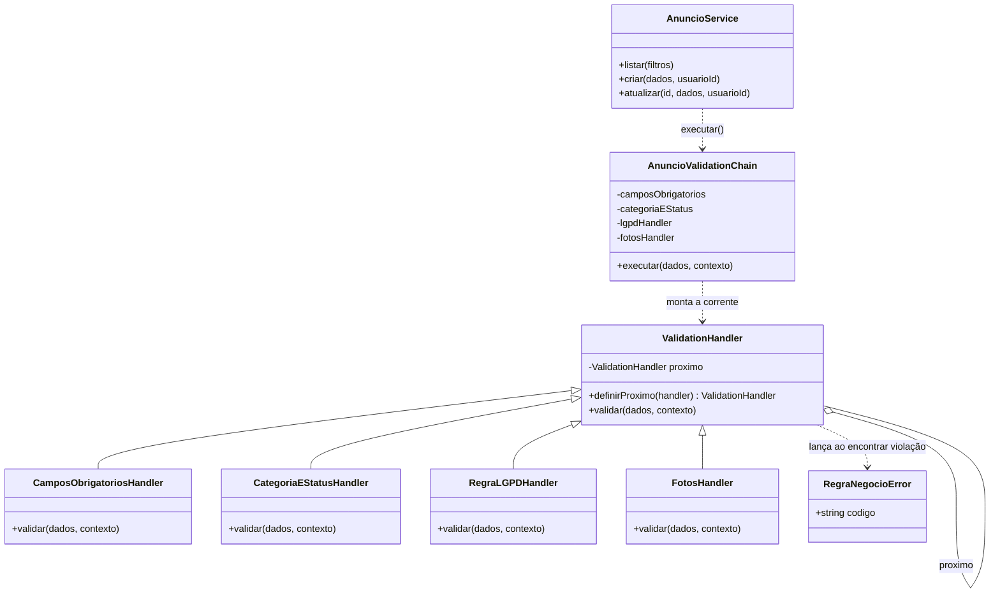
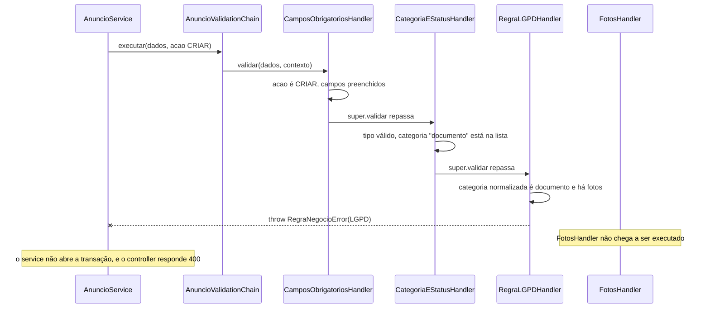

# Padrões de Projeto — Radar UFLA

> Sprint 5 — Issue [#32](https://github.com/Matheus-Castro-Paula/Radar-UFLA/issues/32) | Responsável pelo documento: Tech Lead (`@BernarDEVthomaz`) | Implementação: PR [#38](https://github.com/Matheus-Castro-Paula/Radar-UFLA/pull/38) (`@Matheus-Castro-Paula`), Issues [#30](https://github.com/Matheus-Castro-Paula/Radar-UFLA/issues/30) e [#31](https://github.com/Matheus-Castro-Paula/Radar-UFLA/issues/31)

Este documento registra um problema real de projeto encontrado no back-end do Radar UFLA, as alternativas avaliadas (incluindo não usar padrão nenhum), o padrão adotado e sua aplicação no código.

| Padrão                                         | Categoria (GoF) | Onde foi aplicado                                                                               | Problema que resolve                                                        | Decisão                                                       |
| ---------------------------------------------- | --------------- | ----------------------------------------------------------------------------------------------- | --------------------------------------------------------------------------- | ------------------------------------------------------------- |
| **Chain of Responsibility** (Cadeia de Responsabilidade) | Comportamental  | Validações de anúncio — [`src/services/validations/`](../../API/Back-End/src/services/validations/) | Sequência de validações duplicada e rígida dentro do `AnuncioService`       | [ADR-04](../projeto/decisoes-de-projeto.md#adr-04--adotar-chain-of-responsibility-nas-validações-de-anúncio) |

## 1. Problema concreto observado

### 1.1 Onde estava

No [`AnuncioService.js`](https://github.com/Matheus-Castro-Paula/Radar-UFLA/blob/593156b/API/Back-End/src/services/AnuncioService.js) criado na Sprint 4 (commit [`593156b`](https://github.com/Matheus-Castro-Paula/Radar-UFLA/commit/593156b)), cerca de **80 das 214 linhas** eram regras de validação: constantes, seis funções `validar*`/`normalizar*` e a orquestração delas. A mesma sequência de validações era montada **à mão, duas vezes, de formas diferentes**:

**Criação** — [linhas 130–139](https://github.com/Matheus-Castro-Paula/Radar-UFLA/blob/593156b/API/Back-End/src/services/AnuncioService.js#L130-L139)

```js
async criar(dados, usuarioId) {
  const fotos = dados.fotos || [];

  // Ordem do diagrama 2.3: obrigatórios → RN-04 → regras de foto → persistência
  validarCamposObrigatorios(dados);
  validarTipoEStatus(dados);
  const categoria = normalizarCategoria(dados.categoria);
  validarCategoria(categoria);
  validarRegraLGPD(categoria, fotos);
  validarFotos(fotos);
  // ... transação no banco
```

**Edição** — [linhas 164–179](https://github.com/Matheus-Castro-Paula/Radar-UFLA/blob/593156b/API/Back-End/src/services/AnuncioService.js#L164-L179)

```js
async atualizar(id, dados, usuarioId) {
  // ... busca o anúncio e calcula o estado final
  validarTipoEStatus(dados);
  if (novaCategoria !== undefined) validarCategoria(novaCategoria);
  validarRegraLGPD(categoriaFinal, fotosFinais);
  if (substituiFotos) validarFotos(fotosFinais);
  // ... transação no banco
```

### 1.2 Por que isso era um problema

1. **A ordem e as condições estavam duplicadas e já divergiam.** A criação fazia seis chamadas fixas; a edição fazia quatro, duas delas condicionais (`if`). Quem adicionasse uma regra precisava lembrar de editar os dois métodos e de acertar a condição em cada um. Foi exatamente esse tipo de detalhe que permitiu, durante a Sprint 4, que uma categoria escrita de outro jeito contornasse a `RN-04` ([incident-log](../../.harness/incident-log/2026-10-categoria-contornava-rn04.md)).
2. **O service não estava fechado para modificação (OCP).** Toda regra nova obrigava a abrir `criar` e `atualizar`, métodos que também cuidam da transação e da persistência. Uma alteração de validação passava a arriscar o código de gravação.
3. **O service acumulava duas responsabilidades (SRP).** Ele decidia *quais* regras valiam para cada operação e *em que ordem*, além de orquestrar o banco.
4. **Há regras novas previstas, todas do mesmo tipo** ("verificar os dados e, se algo estiver errado, interromper a operação"):

| Regra prevista                                                              | Origem                                                                                     | Situação hoje                                                                 |
| --------------------------------------------------------------------------- | ------------------------------------------------------------------------------------------ | ----------------------------------------------------------------------------- |
| Bloquear CPF e números de documento no título/descrição                     | `RN-04` (LGPD)                                                                             | Só existe no front-end (`validarLGPDPublicacao` em `app.js`); a API aceita    |
| Data/hora do achado ou da perda obrigatória                                 | `RF-07`; refinamento 2 de [`modelagem.md`](../modelagem/modelagem.md#6-refinamentos-identificados) | Campo ainda não existe no banco                                              |
| Tamanho máximo de 5 MB por foto                                             | `RF-08`; melhoria M-04 de [`decisoes-de-projeto.md`](../projeto/decisoes-de-projeto.md#4-melhorias-e-refatorações-identificadas) | Depende do upload real (Issue #10)                                            |
| Categorias gerenciadas pelo administrador, lidas do banco                   | `RF-11`; melhoria M-03                                                                     | Lista fixa no código                                                          |

Com a estrutura antiga, cada linha dessa tabela significaria mais um `if` em dois métodos diferentes.

## 2. Alternativas consideradas

### Alternativa 1 — Não usar padrão (manter as funções e a orquestração no service)

- **Como seria:** continuar com as funções `validar*` e adicionar novas chamadas em `criar` e `atualizar`. Uma variação mais organizada seria guardar, para cada operação, um array de funções e percorrê-lo.
- **Vantagens:** é o código mais curto e mais direto; nenhum arquivo novo; nada de herança. Com as quatro regras de hoje, funciona.
- **Desvantagens:** a decisão de "qual regra vale em qual operação, e quando" continua espalhada pelo service, em `if`s. Não existe um contrato que diga o que uma validação precisa implementar. A variação com array de funções resolve parte da duplicação, mas cada função ainda precisaria receber parâmetros diferentes (`dados`, `categoria`, `fotos`), e as condições da edição continuariam do lado de fora.

### Alternativa 2 — Strategy

- **Como seria:** uma estratégia de validação por operação (`ValidacaoCriacao`, `ValidacaoEdicao`), escolhida pelo service.
- **Vantagens:** separa a criação da edição de forma explícita.
- **Desvantagens:** Strategy serve para escolher **um** algoritmo entre vários intercambiáveis. Aqui o problema é uma **sequência** de verificações independentes. Cada estratégia teria que repetir a lista completa de regras (a `RN-04` estaria nas duas), então a duplicação apenas mudaria de lugar.

### Alternativa 3 — Chain of Responsibility (adotada)

- **Como é:** cada regra vira um *handler* com a mesma interface; os handlers são encadeados uma única vez, e os dados do anúncio passam por eles em ordem. Qualquer handler pode interromper a corrente lançando `RegraNegocioError`. A operação (criar, atualizar, listar) viaja junto, em `contexto.acao`, e cada handler decide se se aplica a ela.
- **Vantagens:** cada regra fica em um arquivo; a ordem fica em um único lugar; regra nova = classe nova + uma linha no montador.
- **Desvantagens:** mais arquivos e uma indireção a mais; cada handler precisa lembrar de repassar a requisição ao próximo (seção 7).

### Comparação

| Critério                                       | 1. Sem padrão                  | 2. Strategy                         | 3. Chain of Responsibility           |
| ---------------------------------------------- | ------------------------------ | ----------------------------------- | ------------------------------------ |
| Adicionar uma regra nova                       | Editar `criar` **e** `atualizar` | Editar as duas estratégias          | Nova classe + 1 linha no montador    |
| Regras diferentes por operação                 | `if`s espalhados no service    | Lista inteira duplicada por estratégia | O handler consulta `contexto.acao` |
| Regra testável isoladamente                    | Sim (função solta)             | Não (presa à estratégia)            | Sim (um handler por arquivo)         |
| Arquivos novos                                 | 0                              | 2–3                                 | 6 (base, montador, 4 handlers)       |
| Complexidade adicionada                        | Nenhuma                        | Média                               | Média                                |

## 3. Padrão adotado e justificativa

**Chain of Responsibility** (GoF, padrão comportamental): uma requisição percorre uma cadeia de objetos com a mesma interface, e cada objeto decide se trata a requisição, se a interrompe ou se a repassa ao próximo. Quem dispara a requisição não precisa conhecer quais objetos existem na cadeia.

**Adaptação ao projeto.** Na forma clássica, apenas um elo "assume" a requisição. Aqui usamos a variação em que **todos os elos verificam** e repassam, e **qualquer elo pode encerrar** a corrente ao encontrar uma violação, lançando `RegraNegocioError`. É a forma adequada para validação, em que todas as regras precisam ser checadas até a primeira falha. Cada handler sobrescreve `validar(dados, contexto)`: faz a sua verificação e, se nada estiver errado, chama `super.validar(dados, contexto)`, que repassa ao próximo elo.

**Por que este padrão, e não as alternativas:**

- Resolve os quatro pontos da seção 1.2: a escolha e a ordem das regras saem do service (pontos 1 e 3) e regra nova não exige abrir `criar`/`atualizar` (ponto 2, OCP).
- As regras previstas na tabela da seção 1.2 têm todas o mesmo formato — recebem o anúncio e aprovam ou interrompem —, que é exatamente a interface de um handler.
- Ao contrário da alternativa 1, o contrato de uma validação fica explícito na classe base `ValidationHandler`, e cada handler decide sozinho se se aplica à operação (por exemplo, `CamposObrigatoriosHandler` só atua quando `contexto.acao` é `CRIAR`; `FotosHandler` só atua quando há fotos nos dados). Isso elimina os `if`s de condição do service.
- O padrão não foi inserido apenas para cumprir a atividade: ele é aplicado onde o projeto tinha duplicação comprovada (seção 1.1) e onde há quatro regras novas já identificadas em requisitos e no backlog.

## 4. Representação da aplicação do padrão

### 4.1 Diagrama de classes



- `ValidationHandler.validar` só repassa ao `proximo`. Cada handler concreto sobrescreve `validar`, faz a sua verificação e chama `super.validar(dados, contexto)` para seguir a corrente.
- `definirProximo` devolve o handler recebido, o que permite encadear em uma linha: `a.definirProximo(b).definirProximo(c)`.
- O módulo `AnuncioValidationChain` exporta **uma única instância**, criada na primeira importação; os handlers não guardam estado entre requisições.

### 4.2 Diagrama de sequência: criação de anúncio de documento com foto



### 4.3 A corrente e o que cada elo faz em cada operação

A ordem é definida uma vez, no construtor de [`AnuncioValidationChain`](../../API/Back-End/src/services/validations/AnuncioValidationChain.js): **`CamposObrigatoriosHandler` → `CategoriaEStatusHandler` → `RegraLGPDHandler` → `FotosHandler`**, a mesma ordem do diagrama 2.3 de [`modelagem.md`](../modelagem/modelagem.md). O `AnuncioService` chama a mesma corrente nas três operações, mudando só `contexto.acao`:

| Handler                      | `CRIAR` (`criar`)                     | `ATUALIZAR` (`atualizar`)                                        | `LISTAR` (`listar` com filtro `tipo`) |
| ---------------------------- | ------------------------------------- | ---------------------------------------------------------------- | ------------------------------------- |
| `CamposObrigatoriosHandler`  | Verifica os 5 campos obrigatórios     | Não atua                                                         | Não atua                              |
| `CategoriaEStatusHandler`    | Confere `tipo`, `status` e categoria normalizada contra as listas fechadas | Idem, sobre o estado final                       | Confere o `tipo` do filtro            |
| `RegraLGPDHandler`           | `RN-04`: documento não pode ter foto  | `RN-04` sobre o estado final (pega a troca de categoria)         | Sem efeito (não há categoria nem fotos) |
| `FotosHandler`               | `RF-08`: até 3 fotos JPG/PNG/WEBP, se houver | Idem, sobre as fotos finais                               | Sem efeito                            |

Na **edição**, o `AnuncioService` monta antes o **estado final** (anúncio atual + alterações recebidas, com a categoria normalizada e a lista final de fotos) e é esse objeto que percorre a corrente. Assim a `RN-04` continua valendo sobre o resultado da edição, como decidido no ADR-03.

Os dois handlers que dependem da categoria (`CategoriaEStatusHandler` e `RegraLGPDHandler`) **normalizam a categoria por conta própria** (`trim` + minúsculas). Com isso, a proteção contra `" DOCUMENTO "` não depende de outro elo ter feito a normalização antes.

## 5. Participantes

| Papel no padrão (GoF)         | Módulo                         | Arquivo                                                                                                                   | Responsabilidade                                                                                          | Commit |
| ----------------------------- | ------------------------------ | ------------------------------------------------------------------------------------------------------------------------- | --------------------------------------------------------------------------------------------------------- | ------ |
| **Handler** (base)            | `ValidationHandler`            | [`validations/ValidationHandler.js`](../../API/Back-End/src/services/validations/ValidationHandler.js)                    | Guarda o próximo elo (`definirProximo`) e repassa a requisição (`validar`)                               | [`c05a69c`](https://github.com/Matheus-Castro-Paula/Radar-UFLA/commit/c05a69c) |
| **ConcreteHandler**           | `CamposObrigatoriosHandler`    | [`validations/CamposObrigatoriosHandler.js`](../../API/Back-End/src/services/validations/CamposObrigatoriosHandler.js)    | Na criação: título, descrição, tipo, categoria e local preenchidos                                        | [`e26c6aa`](https://github.com/Matheus-Castro-Paula/Radar-UFLA/commit/e26c6aa) |
| **ConcreteHandler**           | `CategoriaEStatusHandler`      | [`validations/CategoriaEStatusHandler.js`](../../API/Back-End/src/services/validations/CategoriaEStatusHandler.js)        | `tipo`, `status` e categoria (normalizada) dentro das listas fechadas                                     | [`e26c6aa`](https://github.com/Matheus-Castro-Paula/Radar-UFLA/commit/e26c6aa) |
| **ConcreteHandler**           | `RegraLGPDHandler`             | [`validations/RegraLGPDHandler.js`](../../API/Back-End/src/services/validations/RegraLGPDHandler.js)                      | `RN-04`: categoria `documento` não pode ter foto                                                           | [`e26c6aa`](https://github.com/Matheus-Castro-Paula/Radar-UFLA/commit/e26c6aa) |
| **ConcreteHandler**           | `FotosHandler`                 | [`validations/FotosHandler.js`](../../API/Back-End/src/services/validations/FotosHandler.js)                              | `RF-08`: lista de até 3 URLs, JPG/PNG/WEBP                                                                | [`e26c6aa`](https://github.com/Matheus-Castro-Paula/Radar-UFLA/commit/e26c6aa) |
| **Montador da corrente**      | `AnuncioValidationChain`       | [`validations/AnuncioValidationChain.js`](../../API/Back-End/src/services/validations/AnuncioValidationChain.js)          | Instancia os handlers, define a ordem e expõe `executar(dados, contexto)`                                 | [`cc1e2b3`](https://github.com/Matheus-Castro-Paula/Radar-UFLA/commit/cc1e2b3) |
| **Client**                    | `AnuncioService`               | [`services/AnuncioService.js`](../../API/Back-End/src/services/AnuncioService.js)                                         | Monta os dados (o estado final, na edição), dispara a corrente e só depois abre a transação               | [`d6b6a3d`](https://github.com/Matheus-Castro-Paula/Radar-UFLA/commit/d6b6a3d) |
| **Interrupção da corrente**   | `RegraNegocioError`            | [`services/RegraNegocioError.js`](../../API/Back-End/src/services/RegraNegocioError.js)                                   | Erro com código de negócio; o controller o traduz em status HTTP (ADR-01)                                 | Sprint 4 |

**O que percorre a corrente** (a "requisição" do padrão):

| Parâmetro        | Conteúdo                                                                                         |
| ---------------- | ------------------------------------------------------------------------------------------------ |
| `dados`          | Na criação, o corpo recebido. Na edição, o estado final consolidado. Na listagem, `{ tipo }`.     |
| `contexto.acao`  | `"CRIAR"`, `"ATUALIZAR"` ou `"LISTAR"`; usado pelo handler para decidir se se aplica              |

## 6. Situação anterior × solução adotada

### 6.1 Antes — commit [`593156b`](https://github.com/Matheus-Castro-Paula/Radar-UFLA/commit/593156b)

Trechos na seção 1.1. As validações eram funções internas do `AnuncioService`, chamadas em sequência fixa na criação e com `if`s na edição.

### 6.2 Depois — PR [#38](https://github.com/Matheus-Castro-Paula/Radar-UFLA/pull/38), commits [`c05a69c`](https://github.com/Matheus-Castro-Paula/Radar-UFLA/commit/c05a69c), [`e26c6aa`](https://github.com/Matheus-Castro-Paula/Radar-UFLA/commit/e26c6aa), [`cc1e2b3`](https://github.com/Matheus-Castro-Paula/Radar-UFLA/commit/cc1e2b3) e [`d6b6a3d`](https://github.com/Matheus-Castro-Paula/Radar-UFLA/commit/d6b6a3d)

**`AnuncioService.criar`** — [linhas 60–66](https://github.com/Matheus-Castro-Paula/Radar-UFLA/blob/e2eaea6/API/Back-End/src/services/AnuncioService.js#L60-L66): toda a validação virou uma chamada.

```js
async criar(dados, usuarioId) {
  // 1. Delega TODAS as validações para a corrente (Chain of Responsibility)
  await anuncioValidationChain.executar(dados, { acao: "CRIAR" });

  const fotos = dados.fotos || [];
  const categoria = String(dados.categoria).trim().toLowerCase();
  // 2. Persistência ...
```

**Montagem da corrente** — [`AnuncioValidationChain.js`](https://github.com/Matheus-Castro-Paula/Radar-UFLA/blob/e2eaea6/API/Back-End/src/services/validations/AnuncioValidationChain.js#L13-L17): a ordem fica em um só lugar.

```js
// Encadeamento: Campos Obrigatorios -> Categoria/Status -> LGPD -> Fotos
this.camposObrigatorios
  .definirProximo(this.categoriaEStatus)
  .definirProximo(this.lgpdHandler)
  .definirProximo(this.fotosHandler);
```

**Um elo da corrente** — [`RegraLGPDHandler.js`](https://github.com/Matheus-Castro-Paula/Radar-UFLA/blob/e2eaea6/API/Back-End/src/services/validations/RegraLGPDHandler.js): a `RN-04` em um arquivo próprio.

```js
class RegraLGPDHandler extends ValidationHandler {
  async validar(dados, contexto = {}) {
    const categoria = String(dados.categoria || "").trim().toLowerCase();
    const fotos = dados.fotos || [];
    const ehDocumento = categoria === "documento";
    const temFotos = Array.isArray(fotos) && fotos.length > 0;

    if (ehDocumento && temFotos) {
      throw new RegraNegocioError(RegraNegocioError.CODIGOS.LGPD, "Não é permitido enviar foto de documento pessoal (RN-04 / LGPD). ...");
    }

    await super.validar(dados, contexto);
  }
}
```

### 6.3 Comparação

| Critério                                          | Antes (`593156b`)                                   | Depois (`e2eaea6`)                                                        |
| ------------------------------------------------- | --------------------------------------------------- | ------------------------------------------------------------------------- |
| Tamanho do `AnuncioService`                       | 214 linhas                                          | 156 linhas                                                                |
| Código de validação dentro do `AnuncioService`    | ~80 linhas (constantes, 6 funções e 2 orquestrações) | 3 chamadas a `executar()` e a montagem do estado final da edição (~7 linhas) |
| Onde fica a ordem das validações                  | Dentro de `criar` e de `atualizar`, repetida        | Em um único lugar: construtor de `AnuncioValidationChain`                 |
| Como uma regra se aplica só a certas operações   | `if`s no `AnuncioService`                           | O próprio handler consulta `contexto.acao` ou os dados                    |
| Passos para adicionar uma regra nova              | Nova função + editar `criar` + editar `atualizar`   | Novo handler + 1 linha em `AnuncioValidationChain`                        |
| `AnuncioService` precisa mudar para regra nova?   | Sim                                                 | Não                                                                       |
| Regra testável sem banco e sem Express            | Sim, mas como função interna não exportada          | Sim, cada handler é uma classe exportada                                  |

## 7. Benefícios, custos e limitações

**Benefícios**

- **Aberto/Fechado:** regras novas (seção 1.2) entram como handlers novos, sem modificar `AnuncioService`.
- **Responsabilidade única:** o service orquestra a persistência; cada handler cuida de uma regra; o montador decide a composição.
- **Sem divergência entre operações:** criação, edição e listagem usam a mesma corrente; o que muda é só `contexto.acao`.
- **Regras sensíveis ficam visíveis:** a `RN-04` tem arquivo próprio, o que facilita a revisão de código e a auditoria de LGPD.

**Custos**

- Seis arquivos novos e uma camada de indireção: para entender uma validação é preciso olhar o montador e o handler.
- Curva de aprendizado para quem entra no código e não conhece o padrão. Mitigada por este documento e pelo diagrama 3.3 de [`modelagem.md`](../modelagem/modelagem.md).

**Limitações**

- **O repasse depende de cada handler.** Como cada handler sobrescreve `validar` e precisa chamar `super.validar(...)` no final, um handler novo que esqueça essa linha **interrompe a corrente sem nenhum erro**: as regras seguintes deixam de rodar. Uma variação com Template Method (`validar` fixo na base, chamando um método `verificar` que cada handler implementa) eliminaria esse risco; está registrada como melhoria M-07 em [`decisoes-de-projeto.md`](../projeto/decisoes-de-projeto.md#4-melhorias-e-refatorações-identificadas). Até lá, essa linha é item obrigatório do code review.
- **O usuário vê um erro por vez:** a corrente para na primeira violação. Se o formulário tiver dois problemas, o segundo só aparece depois de corrigir o primeiro.
- **A normalização da categoria está repetida** em `CategoriaEStatusHandler`, `RegraLGPDHandler` e `AnuncioService`. Isso protege contra erros de ordem, mas são três lugares para manter iguais.
- **Não cobre autorização.** A verificação de autoria (`RN-02`, `buscarAnuncioDoAutor`) depende de consultar o banco e continua fora da corrente.
- **Ainda não há testes automatizados** dos handlers. Eles estão previstos para a Sprint 7; nesta sprint, o funcionamento foi verificado pelos cenários da seção 8.

## 8. Evidências

| Item                                      | Issue                                                                                   | Código ou artefato                                                                 | Evidência                       |
| ----------------------------------------- | --------------------------------------------------------------------------------------- | ---------------------------------------------------------------------------------- | ------------------------------- |
| Classe base, montador e refatoração do service | [#30](https://github.com/Matheus-Castro-Paula/Radar-UFLA/issues/30)               | [`services/validations/`](../../API/Back-End/src/services/validations/), [`AnuncioService.js`](../../API/Back-End/src/services/AnuncioService.js) | [`c05a69c`](https://github.com/Matheus-Castro-Paula/Radar-UFLA/commit/c05a69c), [`cc1e2b3`](https://github.com/Matheus-Castro-Paula/Radar-UFLA/commit/cc1e2b3), [`d6b6a3d`](https://github.com/Matheus-Castro-Paula/Radar-UFLA/commit/d6b6a3d) (PR [#38](https://github.com/Matheus-Castro-Paula/Radar-UFLA/pull/38)) |
| Handlers concretos                        | [#30](https://github.com/Matheus-Castro-Paula/Radar-UFLA/issues/30), [#31](https://github.com/Matheus-Castro-Paula/Radar-UFLA/issues/31) | [`services/validations/`](../../API/Back-End/src/services/validations/)            | [`e26c6aa`](https://github.com/Matheus-Castro-Paula/Radar-UFLA/commit/e26c6aa) |
| Documento de padrões, ADR-04 e modelagem  | [#32](https://github.com/Matheus-Castro-Paula/Radar-UFLA/issues/32)                     | Este arquivo, [`decisoes-de-projeto.md`](../projeto/decisoes-de-projeto.md), [`modelagem.md`](../modelagem/modelagem.md#33-diagrama-de-classes-camada-de-serviços-de-anúncios) | PR [#37](https://github.com/Matheus-Castro-Paula/Radar-UFLA/pull/37) |
| Funcionamento antes da refatoração        | —                                                                                       | API rodando em Docker, commit `d16aa0e`                                            | [`sprint-05-validacoes-antes.txt`](../sprints/evidencias/sprint-05-validacoes-antes.txt) (12/12) |
| Funcionamento após a refatoração          | —                                                                                       | API rodando em Docker, commit `e2eaea6`                                            | [`sprint-05-validacoes-depois.txt`](../sprints/evidencias/sprint-05-validacoes-depois.txt) (12/12) |

As mensagens dos commits do PR #38 citam `#29` por engano; a implementação corresponde às Issues #30 e #31.

**Cenários executados antes e depois da refatoração** (mesmo roteiro, mesmos resultados esperados):

| #  | Cenário                                              | Esperado | Antes | Depois |
| -- | ---------------------------------------------------- | -------- | ----- | ------ |
| 1  | Criar anúncio sem token                              | 401      | 401   | 401    |
| 2  | Documento **com** foto (`RN-04`)                     | 400      | 400   | 400    |
| 3  | Categoria `" DOCUMENTO "` com foto (normalização)    | 400      | 400   | 400    |
| 4  | Categoria inexistente                                | 400      | 400   | 400    |
| 5  | Campo obrigatório faltando                           | 400      | 400   | 400    |
| 6  | Mais de 3 fotos                                      | 400      | 400   | 400    |
| 7  | Foto com extensão inválida                           | 400      | 400   | 400    |
| 8  | Documento **sem** foto                               | 201      | 201   | 201    |
| 9  | Eletrônico com foto                                  | 201      | 201   | 201    |
| 10 | Edição: anúncio com foto passa a ser `documento`     | 400      | 400   | 400    |
| 11 | Edição só do título (sem categoria e sem fotos)      | 200      | 200   | 200    |
| 12 | Vitrine pública sem e-mail/telefone do autor         | 200      | 200   | 200    |

"Antes": executado em 25/10/2026 sobre o commit `d16aa0e` (com o `AnuncioService` igual ao de `593156b`). "Depois": executado em 26/10/2026 sobre o commit `e2eaea6` (merge do PR #38). **12 de 12 cenários iguais nas duas execuções, com as mesmas mensagens de erro**: a refatoração não alterou o comportamento da API.

## 9. Relação com os demais artefatos

- **Decisão registrada:** [ADR-04 em `decisoes-de-projeto.md`](../projeto/decisoes-de-projeto.md#adr-04--adotar-chain-of-responsibility-nas-validações-de-anúncio).
- **Modelo atualizado:** [diagrama 3.3 de `modelagem.md`](../modelagem/modelagem.md#33-diagrama-de-classes-camada-de-serviços-de-anúncios).
- **Decisões anteriores preservadas:** ADR-01 (regra de negócio no service, `RegraNegocioError` com código) e ADR-03 (`RN-04` no back-end, sobre o estado final) continuam valendo; o padrão só reorganiza onde essas regras moram.
