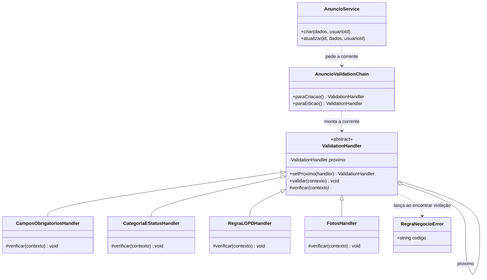
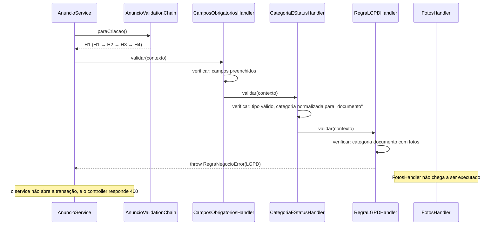

# Padrões de Projeto — Radar UFLA

> Sprint 5 — Issue [#32](https://github.com/Matheus-Castro-Paula/Radar-UFLA/issues/32) | Responsável pelo documento: Tech Lead (`@BernarDEVthomaz`) | Implementação: Issues [#30](https://github.com/Matheus-Castro-Paula/Radar-UFLA/issues/30) e [#31](https://github.com/Matheus-Castro-Paula/Radar-UFLA/issues/31) (`@Matheus-Castro-Paula`, `@artxisto`)

Este documento registra um problema real de projeto encontrado no back-end do Radar UFLA, as alternativas avaliadas (incluindo não usar padrão nenhum), o padrão adotado e sua aplicação no código.

| Padrão                                         | Categoria (GoF) | Onde foi aplicado                                                                               | Problema que resolve                                                        | Decisão                                                       |
| ---------------------------------------------- | --------------- | ----------------------------------------------------------------------------------------------- | --------------------------------------------------------------------------- | ------------------------------------------------------------- |
| **Chain of Responsibility** (Cadeia de Responsabilidade) | Comportamental  | Validações de anúncio — [`src/services/validations/`](../../API/Back-End/src/services/validations/) | Sequência de validações duplicada e rígida dentro do `AnuncioService`       | [ADR-04](../projeto/decisoes-de-projeto.md#adr-04--adotar-chain-of-responsibility-nas-validações-de-anúncio) |

## 1. Problema concreto observado

### 1.1 Onde está

No [`AnuncioService.js`](https://github.com/Matheus-Castro-Paula/Radar-UFLA/blob/593156b/API/Back-End/src/services/AnuncioService.js) criado na Sprint 4 (commit [`593156b`](https://github.com/Matheus-Castro-Paula/Radar-UFLA/commit/593156b)), cerca de **80 das 214 linhas** são regras de validação: constantes, seis funções `validar*`/`normalizar*` e a orquestração delas. A mesma sequência de validações é montada **à mão, duas vezes, de formas diferentes**:

**Criação** — [linhas 130–139](https://github.com/Matheus-Castro-Paula/Radar-UFLA/blob/593156b/API/Back-End/src/services/AnuncioService.js#L130-L139)

```js
async criar(dados, usuarioId) {
  const fotos = dados.fotos || [];

  // Ordem do diagrama 2.3: obrigatórios → RN-04 → regras de foto → persistência
  validarCamposObrigatorios(dados);
  validarTipoEStatus(dados);
  const categoria = normalizarCategoria(dados.categoria);
  validarCategoria(categoria);
  validarRegraLGPD(categoria, fotos);
  validarFotos(fotos);
  // ... transação no banco
```

**Edição** — [linhas 164–179](https://github.com/Matheus-Castro-Paula/Radar-UFLA/blob/593156b/API/Back-End/src/services/AnuncioService.js#L164-L179)

```js
async atualizar(id, dados, usuarioId) {
  // ... busca o anúncio e calcula o estado final
  validarTipoEStatus(dados);
  if (novaCategoria !== undefined) validarCategoria(novaCategoria);
  validarRegraLGPD(categoriaFinal, fotosFinais);
  if (substituiFotos) validarFotos(fotosFinais);
  // ... transação no banco
```

### 1.2 Por que isso é um problema

1. **A ordem e as condições estão duplicadas e já divergem.** A criação faz seis chamadas fixas; a edição faz quatro, duas delas condicionais (`if`). Quem adiciona uma regra precisa lembrar de editar os dois métodos e de acertar a condição em cada um. Foi exatamente esse tipo de detalhe que permitiu, durante a Sprint 4, que uma categoria escrita de outro jeito contornasse a `RN-04` ([incident-log](../../.harness/incident-log/2026-10-categoria-contornava-rn04.md)).
2. **O service não está fechado para modificação (OCP).** Toda regra nova obriga a abrir `criar` e `atualizar`, métodos que também cuidam da transação e da persistência. Uma alteração de validação passa a arriscar o código de gravação.
3. **O service acumula duas responsabilidades (SRP).** Ele decide *quais* regras valem para cada operação e *em que ordem*, além de orquestrar o banco.
4. **Há regras novas previstas, todas do mesmo tipo** ("verificar os dados e, se algo estiver errado, interromper a operação"):

| Regra prevista                                                              | Origem                                                                                     | Situação hoje                                                                 |
| --------------------------------------------------------------------------- | ------------------------------------------------------------------------------------------ | ----------------------------------------------------------------------------- |
| Bloquear CPF e números de documento no título/descrição                     | `RN-04` (LGPD)                                                                             | Só existe no front-end (`validarLGPDPublicacao` em `app.js`); a API aceita    |
| Data/hora do achado ou da perda obrigatória                                 | `RF-07`; refinamento 2 de [`modelagem.md`](../modelagem/modelagem.md#6-refinamentos-identificados) | Campo ainda não existe no banco                                              |
| Tamanho máximo de 5 MB por foto                                             | `RF-08`; melhoria M-04 de [`decisoes-de-projeto.md`](../projeto/decisoes-de-projeto.md#4-melhorias-e-refatorações-identificadas) | Depende do upload real (Issue #10)                                            |
| Categorias gerenciadas pelo administrador, lidas do banco                   | `RF-11`; melhoria M-03                                                                     | Lista fixa no código                                                          |

Com a estrutura atual, cada linha dessa tabela significaria mais um `if` em dois métodos diferentes.

## 2. Alternativas consideradas

### Alternativa 1 — Não usar padrão (manter as funções e a orquestração no service)

- **Como seria:** continuar com as funções `validar*` e adicionar novas chamadas em `criar` e `atualizar`. Uma variação mais organizada seria guardar, para cada operação, um array de funções e percorrê-lo.
- **Vantagens:** é o código mais curto e mais direto; nenhum arquivo novo; nada de herança. Com as quatro regras de hoje, funciona.
- **Desvantagens:** a decisão de "qual regra vale em qual operação, e quando" continua espalhada pelo service, em `if`s. Não existe um contrato que diga o que uma validação precisa implementar. A variação com array de funções resolve parte da duplicação, mas cada função ainda precisaria receber parâmetros diferentes (`dados`, `categoria`, `fotos`), e as condições da edição continuariam do lado de fora.

### Alternativa 2 — Strategy

- **Como seria:** uma estratégia de validação por operação (`ValidacaoCriacao`, `ValidacaoEdicao`), escolhida pelo service.
- **Vantagens:** separa a criação da edição de forma explícita.
- **Desvantagens:** Strategy serve para escolher **um** algoritmo entre vários intercambiáveis. Aqui o problema é uma **sequência** de verificações independentes. Cada estratégia teria que repetir a lista completa de regras (a `RN-04` estaria nas duas), então a duplicação apenas mudaria de lugar.

### Alternativa 3 — Chain of Responsibility (adotada)

- **Como seria:** cada regra vira um *handler* com a mesma interface; os handlers são encadeados, e a requisição (o contexto do anúncio) passa por eles em ordem. Qualquer handler pode interromper a corrente lançando `RegraNegocioError`.
- **Vantagens:** cada regra fica em um arquivo; a ordem e a composição de cada operação ficam em um único lugar; regra nova = classe nova + uma linha no montador.
- **Desvantagens:** mais arquivos e uma indireção a mais; a ordem da corrente passa a ser uma decisão que precisa ser documentada (seção 4.3).

### Comparação

| Critério                                       | 1. Sem padrão                  | 2. Strategy                         | 3. Chain of Responsibility           |
| ---------------------------------------------- | ------------------------------ | ----------------------------------- | ------------------------------------ |
| Adicionar uma regra nova                       | Editar `criar` **e** `atualizar` | Editar as duas estratégias          | Nova classe + 1 linha no montador    |
| Regras diferentes por operação                 | `if`s espalhados no service    | Lista inteira duplicada por estratégia | Uma corrente montada por operação |
| Regra testável isoladamente                    | Sim (função solta)             | Não (presa à estratégia)            | Sim (um handler por arquivo)         |
| Arquivos novos                                 | 0                              | 2–3                                 | 6 (base, montador, 4 handlers)       |
| Complexidade adicionada                        | Nenhuma                        | Média                               | Média                                |

## 3. Padrão adotado e justificativa

**Chain of Responsibility** (GoF, padrão comportamental): uma requisição percorre uma cadeia de objetos com a mesma interface, e cada objeto decide se trata a requisição, se a interrompe ou se a repassa ao próximo. Quem dispara a requisição não precisa conhecer quais objetos existem na cadeia.

**Adaptação ao projeto.** Na forma clássica, apenas um elo "assume" a requisição. Aqui usamos a variação em que **todos os elos verificam** e repassam, e **qualquer elo pode encerrar** a corrente ao encontrar uma violação, lançando `RegraNegocioError`. É a forma adequada para validação, em que todas as regras precisam ser checadas até a primeira falha.

**Por que este padrão, e não as alternativas:**

- Resolve os quatro pontos da seção 1.2: a composição por operação sai do service (pontos 1 e 3) e regra nova não exige abrir `criar`/`atualizar` (ponto 2, OCP).
- As regras previstas na tabela da seção 1.2 têm todas o mesmo formato — recebem o anúncio e aprovam ou interrompem —, que é exatamente a interface de um handler.
- Ao contrário da alternativa 1, o contrato de uma validação fica explícito na classe base `ValidationHandler`, e cada handler decide sozinho se se aplica ao contexto (por exemplo, `FotosHandler` não faz nada quando a edição não substitui as fotos). Isso elimina os `if`s de condição do service.
- O padrão não foi inserido apenas para cumprir a atividade: ele é aplicado onde o projeto já tem duplicação comprovada (seção 1.1) e onde há quatro regras novas já identificadas em requisitos e no backlog.

## 4. Representação da aplicação do padrão

### 4.1 Diagrama de classes



`validar(contexto)` é implementado uma única vez na classe base: chama `verificar(contexto)` do próprio handler e, se nada for lançado, repassa ao `proximo`. Cada handler concreto implementa apenas `verificar`.

### 4.2 Diagrama de sequência: criação de anúncio de documento com foto



### 4.3 Correntes montadas por operação

| Operação    | Ordem da corrente                                                                                         | Observação                                                                                         |
| ----------- | --------------------------------------------------------------------------------------------------------- | -------------------------------------------------------------------------------------------------- |
| **Criação** | `CamposObrigatoriosHandler` → `CategoriaEStatusHandler` → `RegraLGPDHandler` → `FotosHandler`             | Mesma ordem do diagrama 2.3 de [`modelagem.md`](../modelagem/modelagem.md): obrigatórios → categoria → RN-04 → fotos |
| **Edição**  | `CategoriaEStatusHandler` → `RegraLGPDHandler` → `FotosHandler`                                            | Na edição os campos são opcionais. `CategoriaEStatusHandler` só valida a categoria se ela foi enviada, e `FotosHandler` só valida se as fotos foram substituídas. A `RN-04` sempre roda sobre o estado final. |

A ordem importa: `CategoriaEStatusHandler` precisa vir antes de `RegraLGPDHandler`, porque é ele que normaliza a categoria (`trim` + minúsculas). Sem isso, `" DOCUMENTO "` passaria pela `RN-04`.

## 5. Participantes

| Papel no padrão (GoF)         | Módulo                         | Arquivo                                                                                                                   | Responsabilidade                                                                                          | Issue |
| ----------------------------- | ------------------------------ | ------------------------------------------------------------------------------------------------------------------------- | --------------------------------------------------------------------------------------------------------- | ----- |
| **Handler** (abstrato)        | `ValidationHandler`            | [`validations/ValidationHandler.js`](../../API/Back-End/src/services/validations/ValidationHandler.js)                    | Define o contrato (`verificar`), guarda o próximo elo e implementa o repasse (`validar`)                  | #30   |
| **ConcreteHandler**           | `CamposObrigatoriosHandler`    | [`validations/CamposObrigatoriosHandler.js`](../../API/Back-End/src/services/validations/CamposObrigatoriosHandler.js)    | Título, descrição, tipo, categoria e local preenchidos                                                    | #31   |
| **ConcreteHandler**           | `CategoriaEStatusHandler`      | [`validations/CategoriaEStatusHandler.js`](../../API/Back-End/src/services/validations/CategoriaEStatusHandler.js)        | Normaliza a categoria e confere `tipo`, `status` e `categoria` contra as listas fechadas                   | #31   |
| **ConcreteHandler**           | `RegraLGPDHandler`             | [`validations/RegraLGPDHandler.js`](../../API/Back-End/src/services/validations/RegraLGPDHandler.js)                      | `RN-04`: categoria `documento` não pode ter foto (estado final)                                           | #30   |
| **ConcreteHandler**           | `FotosHandler`                 | [`validations/FotosHandler.js`](../../API/Back-End/src/services/validations/FotosHandler.js)                              | `RF-08`: até 3 fotos, JPG/PNG/WEBP                                                                        | #31   |
| **Montador da corrente**      | `AnuncioValidationChain`       | [`validations/AnuncioValidationChain.js`](../../API/Back-End/src/services/validations/AnuncioValidationChain.js)          | Instancia os handlers e define a ordem de cada operação (seção 4.3)                                       | #30   |
| **Client**                    | `AnuncioService`               | [`services/AnuncioService.js`](../../API/Back-End/src/services/AnuncioService.js)                                         | Monta o contexto, dispara a corrente e só depois abre a transação                                         | #30   |
| **Interrupção da corrente**   | `RegraNegocioError`            | [`services/RegraNegocioError.js`](../../API/Back-End/src/services/RegraNegocioError.js)                                   | Erro com código de negócio; o controller o traduz em status HTTP (ADR-01)                                 | —     |

**Contexto que percorre a corrente** (a "requisição" do padrão):

| Campo               | Conteúdo                                                                 |
| ------------------- | ------------------------------------------------------------------------ |
| `dados`             | Corpo recebido (`titulo`, `descricao`, `tipo`, `status`, `local_encontro`) |
| `categoria`         | Categoria do estado final, normalizada por `CategoriaEStatusHandler`     |
| `fotos`             | Lista final de fotos (enviadas, ou as atuais quando a edição não as troca) |
| `categoriaInformada`| Se a requisição trouxe categoria (usado na edição)                        |
| `fotosInformadas`   | Se a requisição trouxe fotos (usado na edição)                            |

## 6. Situação anterior × solução adotada

### 6.1 Antes — commit [`593156b`](https://github.com/Matheus-Castro-Paula/Radar-UFLA/commit/593156b)

Trechos na seção 1.1. As validações eram funções internas do `AnuncioService`, chamadas em sequência fixa na criação e com `if`s na edição.

### 6.2 Depois — commit(s) `[A PREENCHER]`

> **[A PREENCHER após o PR das Issues #30 e #31]** — trecho do `AnuncioService.criar` refatorado e de um handler concreto (sugestão: `RegraLGPDHandler`).

```js
// [COLAR AQUI o AnuncioService.criar delegando à corrente]
```

```js
// [COLAR AQUI o RegraLGPDHandler.js]
```

### 6.3 Comparação

| Critério                                          | Antes (`593156b`)                                   | Depois                                                         |
| ------------------------------------------------- | --------------------------------------------------- | -------------------------------------------------------------- |
| Onde fica a ordem das validações                  | Dentro de `criar` e de `atualizar`, repetida        | Em um único lugar: `AnuncioValidationChain`                    |
| Como a edição pula regras que não se aplicam      | `if`s no `AnuncioService`                           | O próprio handler verifica o contexto                          |
| Passos para adicionar uma regra nova              | Nova função + editar `criar` + editar `atualizar`   | Novo handler + 1 linha em `AnuncioValidationChain`             |
| Linhas de validação dentro do `AnuncioService`    | ~80 de 214                                          | `[A PREENCHER]`                                                |
| `AnuncioService` precisa mudar para regra nova?   | Sim                                                 | Não                                                            |
| Regra testável sem banco e sem Express            | Sim, mas como função interna não exportada          | Sim, cada handler é uma classe exportada                       |

## 7. Benefícios, custos e limitações

**Benefícios**

- **Aberto/Fechado:** regras novas (seção 1.2) entram como handlers novos, sem modificar `AnuncioService`.
- **Responsabilidade única:** o service orquestra a persistência; cada handler cuida de uma regra; o montador decide a composição.
- **Menos risco de divergência** entre criação e edição, porque as duas correntes ficam lado a lado em `AnuncioValidationChain`.
- **Regras sensíveis ficam visíveis:** a `RN-04` tem arquivo próprio, o que facilita a revisão de código e a auditoria de LGPD.

**Custos**

- Seis arquivos novos e uma camada de indireção: para entender uma validação é preciso olhar o montador e o handler.
- Herança em JavaScript: a classe base precisa impedir que um handler esqueça de implementar `verificar` (lançando erro na versão abstrata).
- Curva de aprendizado para quem entra no código e não conhece o padrão. Mitigada por este documento e pelo diagrama 3.3 de [`modelagem.md`](../modelagem/modelagem.md).

**Limitações**

- **A ordem é implícita.** Ela está no código do montador, não nos handlers. Uma inversão (por exemplo, `RegraLGPDHandler` antes de `CategoriaEStatusHandler`) reabriria a brecha da categoria não normalizada. Por isso a ordem está documentada na seção 4.3 e deve ser conferida no code review.
- **O usuário vê um erro por vez:** a corrente para na primeira violação. Se o formulário tiver dois problemas, o segundo só aparece depois de corrigir o primeiro.
- **Handlers compartilham o contexto** e um deles o altera (normalização da categoria). Isso cria dependência de ordem entre elos.
- **Não cobre autorização.** A verificação de autoria (`RN-02`, `buscarAnuncioDoAutor`) depende de consultar o banco e continua fora da corrente.
- **Ainda não há testes automatizados** dos handlers. Eles estão previstos para a Sprint 7; nesta sprint, a validação é feita pelos cenários da seção 8.

## 8. Evidências

| Item                                      | Issue                                                                                   | Código ou artefato                                                                 | Evidência                       |
| ----------------------------------------- | --------------------------------------------------------------------------------------- | ---------------------------------------------------------------------------------- | ------------------------------- |
| Estrutura do padrão (base + montador + RN-04) | [#30](https://github.com/Matheus-Castro-Paula/Radar-UFLA/issues/30)                 | [`services/validations/`](../../API/Back-End/src/services/validations/)            | Commit `[A PREENCHER]`          |
| Handlers concretos                        | [#31](https://github.com/Matheus-Castro-Paula/Radar-UFLA/issues/31)                     | [`services/validations/`](../../API/Back-End/src/services/validations/)            | Commit `[A PREENCHER]`          |
| Documento de padrões, ADR-04 e modelagem  | [#32](https://github.com/Matheus-Castro-Paula/Radar-UFLA/issues/32)                     | Este arquivo, [`decisoes-de-projeto.md`](../projeto/decisoes-de-projeto.md), [`modelagem.md`](../modelagem/modelagem.md#33-diagrama-de-classes-camada-de-serviços-de-anúncios) | Commit `[A PREENCHER]`          |
| Funcionamento antes da refatoração        | [#30](https://github.com/Matheus-Castro-Paula/Radar-UFLA/issues/30)                     | API rodando em Docker                                                              | [`sprint-05-validacoes-antes.txt`](../sprints/evidencias/sprint-05-validacoes-antes.txt) (12/12) |
| Funcionamento após a refatoração          | [#30](https://github.com/Matheus-Castro-Paula/Radar-UFLA/issues/30)                     | API rodando em Docker                                                              | `[A PREENCHER: sprint-05-validacoes-depois.txt]` |

**Cenários executados antes e depois da refatoração** (mesmos resultados esperados, para mostrar que o comportamento não mudou):

| #  | Cenário                                              | Esperado | Antes | Depois |
| -- | ---------------------------------------------------- | -------- | ----- | ------ |
| 1  | Criar anúncio sem token                              | 401      | 401   | `[ ]`  |
| 2  | Documento **com** foto (`RN-04`)                     | 400      | 400   | `[ ]`  |
| 3  | Categoria `" DOCUMENTO "` com foto (normalização)    | 400      | 400   | `[ ]`  |
| 4  | Categoria inexistente                                | 400      | 400   | `[ ]`  |
| 5  | Campo obrigatório faltando                           | 400      | 400   | `[ ]`  |
| 6  | Mais de 3 fotos                                      | 400      | 400   | `[ ]`  |
| 7  | Foto com extensão inválida                           | 400      | 400   | `[ ]`  |
| 8  | Documento **sem** foto                               | 201      | 201   | `[ ]`  |
| 9  | Eletrônico com foto                                  | 201      | 201   | `[ ]`  |
| 10 | Edição: anúncio com foto passa a ser `documento`     | 400      | 400   | `[ ]`  |
| 11 | Edição só do título (sem categoria e sem fotos)      | 200      | 200   | `[ ]`  |
| 12 | Vitrine pública sem e-mail/telefone do autor         | 200      | 200   | `[ ]`  |

A coluna "Antes" foi executada em 25/10/2026 sobre o código anterior à refatoração (commit `d16aa0e`, com o `AnuncioService` igual ao de `593156b`): **12 de 12 cenários** com o resultado esperado — saída completa em [`sprint-05-validacoes-antes.txt`](../sprints/evidencias/sprint-05-validacoes-antes.txt). A coluna "Depois" será preenchida rodando o mesmo roteiro sobre o código refatorado.

## 9. Relação com os demais artefatos

- **Decisão registrada:** [ADR-04 em `decisoes-de-projeto.md`](../projeto/decisoes-de-projeto.md#adr-04--adotar-chain-of-responsibility-nas-validações-de-anúncio).
- **Modelo atualizado:** [diagrama 3.3 de `modelagem.md`](../modelagem/modelagem.md#33-diagrama-de-classes-camada-de-serviços-de-anúncios).
- **Decisões anteriores preservadas:** ADR-01 (regra de negócio no service, `RegraNegocioError` com código) e ADR-03 (`RN-04` no back-end, sobre o estado final) continuam valendo; o padrão só reorganiza onde essas regras moram.
