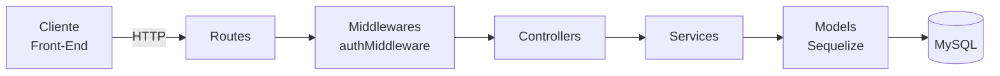

# Decisões de Projeto — Radar UFLA

> Sprint 4 — Issue [#26](https://github.com/Matheus-Castro-Paula/Radar-UFLA/issues/26) | Responsável: Tech Lead (`@BernarDEVthomaz`)

Este documento registra a decomposição do back-end em módulos e camadas, as principais decisões locais de projeto (no formato de ADRs), a análise de coesão e acoplamento do código antes e depois da refatoração da Sprint 4 e as melhorias identificadas.

**Arquivos de código afetados nesta sprint:**

| Arquivo                                                                                              | Papel                                                         | Issue                                                                                                                                                  |
| ---------------------------------------------------------------------------------------------------- | ------------------------------------------------------------- | ------------------------------------------------------------------------------------------------------------------------------------------------------ |
| [`services/AnuncioService.js`](../../API/Back-End/src/services/AnuncioService.js)                    | Regras de negócio de anúncios, incluindo a `RN-04`            | [#24](https://github.com/Matheus-Castro-Paula/Radar-UFLA/issues/24), [#25](https://github.com/Matheus-Castro-Paula/Radar-UFLA/issues/25) |
| [`services/RegraNegocioError.js`](../../API/Back-End/src/services/RegraNegocioError.js)              | Erro de negócio com código, sem dependência de HTTP           | [#24](https://github.com/Matheus-Castro-Paula/Radar-UFLA/issues/24)                                                                     |
| [`controllers/anuncioController.js`](../../API/Back-End/src/controllers/anuncioController.js)        | Tradução HTTP ↔ service                                       | [#24](https://github.com/Matheus-Castro-Paula/Radar-UFLA/issues/24)                                                                     |
| [`routes/anuncioRoutes.js`](../../API/Back-End/src/routes/anuncioRoutes.js)                          | Rotas `/api/anuncios` (leitura pública, escrita com JWT)      | [#24](https://github.com/Matheus-Castro-Paula/Radar-UFLA/issues/24)                                                                     |
| [`server.js`](../../API/Back-End/src/server.js)                                                      | Monta as rotas de anúncios                                    | [#24](https://github.com/Matheus-Castro-Paula/Radar-UFLA/issues/24)                                                                     |
| [`controllers/authController.js`](../../API/Back-End/src/controllers/authController.js)              | Referência do "antes" (não alterado nesta sprint)             | —                                                                                                                                       |

## 1. Decomposição em camadas

O back-end (`API/Back-End/src`) é organizado em quatro camadas. Cada camada conversa apenas com a camada imediatamente abaixo dela.



| Camada          | Pasta                                                        | Responsabilidade                                                                                                                                   | O que **não** deve fazer                                                    |
| --------------- | ------------------------------------------------------------ | -------------------------------------------------------------------------------------------------------------------------------------------------- | --------------------------------------------------------------------------- |
| **Routes**      | [`src/routes/`](../../API/Back-End/src/routes/)              | Mapear verbo + URL para a função do controller e aplicar middlewares (ex.: `autenticarToken` nas rotas de escrita).                                | Conter lógica de negócio ou acessar o banco.                                |
| **Middlewares** | [`src/middlewares/`](../../API/Back-End/src/middlewares/)    | Tratar preocupações transversais antes do controller, como validar o token JWT e preencher `req.usuarioId`.                                       | Decidir regras de negócio do anúncio ou do usuário.                         |
| **Controllers** | [`src/controllers/`](../../API/Back-End/src/controllers/)    | Ler os dados da requisição (`req.body`, `req.params`, `req.usuarioId`), chamar o service e traduzir o resultado ou o erro em status HTTP + JSON.    | Validar regras de negócio, gerar hash/token ou consultar models diretamente. |
| **Services**    | [`src/services/`](../../API/Back-End/src/services/)          | Concentrar as regras de negócio (`RN-04`, só o autor edita, até 3 fotos, categorias válidas). Lançam `RegraNegocioError`; não conhecem `req`/`res`. | Montar respostas HTTP ou depender do Express.                               |
| **Models**      | [`src/models/`](../../API/Back-End/src/models/)              | Mapear as tabelas (`usuarios`, `anuncio`, `foto_anuncio`, `comentario`) e suas associações via Sequelize.                                          | Conter regras de negócio além de restrições de dados.                       |

### Exemplo de fluxo: publicar um anúncio

1. `POST /api/anuncios` chega em [`anuncioRoutes.js`](../../API/Back-End/src/routes/anuncioRoutes.js), que aplica `autenticarToken` e chama `anuncioController.criar`.
2. O **controller** chama `AnuncioService.criar(req.body, req.usuarioId)`. Ele não importa nenhum model.
3. O **service** valida, nesta ordem: campos obrigatórios → `tipo`/`status` → categoria (normalizada e conferida contra a lista `objeto, eletronico, documento, material, outro`) → `RN-04` → fotos (até 3, JPG/PNG/WEBP). Qualquer violação lança `RegraNegocioError` com um código (`VALIDACAO`, `LGPD`, `PROIBIDO`, `NAO_ENCONTRADO`).
4. Se tudo estiver válido, o service grava `Anuncio` e `FotoAnuncio` em uma única transação.
5. O controller converte o resultado em `201 Created` ou, no caso de erro, o código em status: `VALIDACAO`/`LGPD` → 400, `PROIBIDO` → 403, `NAO_ENCONTRADO` → 404.

## 2. Decisões de projeto (ADRs)

| ADR    | Decisão                                         | Situação                                                                   | Issue                                                               | Commits                                                                                                                                                                                                                       |
| ------ | ----------------------------------------------- | -------------------------------------------------------------------------- | ------------------------------------------------------------------- | ----------------------------------------------------------------------------------------------------------------------------------------------------------------------------------------------------------------------------- |
| ADR-01 | Camada de Serviços entre Controllers e Models   | Implementada na Sprint 4                                                   | [#24](https://github.com/Matheus-Castro-Paula/Radar-UFLA/issues/24) | [`c14a05b`](https://github.com/Matheus-Castro-Paula/Radar-UFLA/commit/c14a05b)                                                                                                                                                |
| ADR-02 | Autenticação stateless com JWT + bcrypt         | Implementada na Sprint 3, registrada agora                                 | [#4](https://github.com/Matheus-Castro-Paula/Radar-UFLA/issues/4)   | [`7ebf6ea`](https://github.com/Matheus-Castro-Paula/Radar-UFLA/commit/7ebf6ea)                                                                                                                                                |
| ADR-03 | Regra `RN-04` (LGPD) no back-end, no service    | Implementada na Sprint 4                                                   | [#25](https://github.com/Matheus-Castro-Paula/Radar-UFLA/issues/25) | [`c14a05b`](https://github.com/Matheus-Castro-Paula/Radar-UFLA/commit/c14a05b), [`8ef6025`](https://github.com/Matheus-Castro-Paula/Radar-UFLA/commit/8ef6025)                                                                |

### ADR-01 — Criar uma camada de Serviços entre Controllers e Models

- **Status:** Aceita e implementada (Sprint 4)
- **Contexto:** Até a Sprint 3, o único controller do projeto, o [`authController.js`](../../API/Back-End/src/controllers/authController.js), concentrava tudo na mesma função: leitura da requisição, validação, consulta ao model `Usuario`, hash com bcrypt, assinatura do JWT e montagem da resposta HTTP. O módulo de anúncios, que começa nesta sprint, tem muito mais regras (`RN-04`, permissão do autor, limite de fotos, categorias válidas). Seguir o mesmo padrão faria o controller de anúncios crescer misturando responsabilidades.
- **Alternativas consideradas:**
  1. Manter a lógica nos controllers, como no `authController`.
  2. Colocar as regras de negócio nos models do Sequelize (hooks e métodos de instância).
  3. Criar uma camada `services/` com as regras de negócio, chamada pelos controllers.
- **Decisão:** Alternativa 3. Foi criada a pasta `src/services/` com o [`AnuncioService.js`](../../API/Back-End/src/services/AnuncioService.js). Os erros de negócio são representados por [`RegraNegocioError`](../../API/Back-End/src/services/RegraNegocioError.js), que carrega um código, e não um status HTTP. O [`anuncioController.js`](../../API/Back-End/src/controllers/anuncioController.js) só traduz HTTP ↔ service.
- **Justificativa:** Separa "como a API responde" de "o que o sistema permite". As regras ficam em um só lugar, podem ser testadas sem subir o Express e são reaproveitadas entre criação e edição. Regras nos models (alternativa 2) acoplariam o negócio ao ORM e esconderiam o comportamento em hooks difíceis de rastrear. O `RegraNegocioError` evita que o service precise saber que um erro de LGPD vira "400".
- **Consequências:**
  - ✅ Controller enxuto: cada função tem um `try`, uma chamada ao service e uma resposta.
  - ✅ Regras de negócio testáveis isoladamente; trocar o framework HTTP ou o ORM afeta só uma camada.
  - ⚠️ Mais arquivos e uma indireção a mais em cada fluxo.
  - ⚠️ O time precisa seguir a convenção (nenhuma regra de negócio nova no controller), verificada no code review.
  - ⚠️ O módulo de autenticação ainda segue o padrão antigo (ver melhoria M-01, seção 4).

### ADR-02 — Autenticação stateless com JWT e senhas com bcrypt

- **Status:** Aceita (implementada na Sprint 3, registrada na Sprint 4)
- **Contexto:** Publicar, editar e excluir anúncios exige saber quem é o usuário. O front-end é composto de páginas estáticas ([`API/Front-End`](../../API/Front-End/)) que consomem a API via `fetch`, e o requisito `RNF-03` exige senhas em hash bcrypt.
- **Alternativas consideradas:**
  1. Sessão no servidor (`express-session`) com cookie.
  2. Token JWT assinado, enviado no cabeçalho `Authorization: Bearer <token>`.
  3. Login delegado a um provedor externo (OAuth / conta institucional).
- **Decisão:** Alternativa 2. O [`authController`](../../API/Back-End/src/controllers/authController.js) gera um JWT válido por 24h com o `id` do usuário; o [`authMiddleware`](../../API/Back-End/src/middlewares/authMiddleware.js) valida o token e preenche `req.usuarioId`. As senhas são guardadas apenas como `senha_hash` (bcrypt, custo 10).
- **Justificativa:** O JWT não exige armazenar sessão no servidor nem no banco, funciona bem com um front-end separado e com o container da API reiniciando no Docker. O bcrypt atende o `RNF-03`. O OAuth institucional dependeria de integração com a UFLA, fora do escopo da disciplina.
- **Consequências:**
  - ✅ API sem estado de sessão; qualquer rota passa a ser protegida só adicionando `autenticarToken`, como foi feito nas rotas de escrita de `/api/anuncios`.
  - ✅ O `AnuncioService` usa o `req.usuarioId` vindo do token para aplicar a `RN-02` (só o autor edita ou exclui).
  - ⚠️ Não é possível invalidar um token antes de expirar (logout real exigiria uma lista de bloqueio).
  - ⚠️ **Débito técnico:** a chave `JWT_SECRET` tem um valor padrão fixo no código e está duplicada em `authController.js` e `authMiddleware.js` (ver melhoria M-02).

### ADR-03 — Aplicar a regra de LGPD (`RN-04`) no back-end, dentro do `AnuncioService`

- **Status:** Aceita e implementada (Sprint 4)
- **Contexto:** A regra `RN-04` ([`requisitos.md`](../requisitos/requisitos.md#5-regras-de-negócio)) determina que anúncios de documentos pessoais não podem expor foto do documento (ver também [`modelagem.md`](../modelagem/modelagem.md), seção 2.3, e a Issue [#9](https://github.com/Matheus-Castro-Paula/Radar-UFLA/issues/9)). Até a Sprint 3 a regra existia apenas no front-end: o [`app.js`](../../API/Front-End/app.js) esconde o campo de upload quando a categoria `documento` é escolhida. Qualquer cliente que chamasse a API diretamente conseguiria contorná-la.
- **Alternativas consideradas:**
  1. Manter a validação apenas no front-end.
  2. Validar no controller de anúncios.
  3. Validar no `AnuncioService`, com o front-end apenas refletindo a regra.
  4. Permitir a foto com tarja, marcando a foto com o campo `contem_dado_sensivel` (hoje comentado em [`foto_anuncio.js`](../../API/Back-End/src/models/foto_anuncio.js)).
- **Decisão:** Alternativa 3. A função `validarRegraLGPD` do `AnuncioService` rejeita, com o código `LGPD` (HTTP 400), anúncio da categoria `documento` que tenha fotos. Ela recebe o **estado final** do anúncio, então vale tanto na criação quanto na edição (por exemplo, um anúncio com foto que muda de categoria para `documento`). A categoria é normalizada (`trim` + minúsculas) e conferida contra uma lista fechada, para que variações como `"Documentos"` não escapem da regra. A vitrine pública devolve apenas `id` e `nome` do autor, nunca e-mail ou telefone.
- **Justificativa:** Validação só no front-end (1) pode ser contornada chamando a API diretamente, o que deixaria a plataforma expor dados pessoais. No controller (2), a regra ficaria misturada ao HTTP e teria que ser repetida em criação e edição. A tarja (4) exigiria processamento de imagem e uma nova migration, fora do escopo. Centralizar no service garante uma única fonte da verdade.
- **Consequências:**
  - ✅ A regra vale para qualquer cliente e é testável sem interface (10 cenários em [`sprint-04-api-anuncios.txt`](../sprints/evidencias/sprint-04-api-anuncios.txt)).
  - ✅ Criação e edição reaproveitam a mesma função.
  - ⚠️ A lista de categorias está duplicada entre o service e o `<select>` de [`publicar.html`](../../API/Front-End/publicar.html); se mudar, os dois precisam ser atualizados (ver melhoria M-03).
  - ⚠️ Documentos pessoais ficam apenas com descrição textual, o que pode dificultar a identificação do item pelo dono.
  - ⚠️ O comportamento observável mudou em relação ao texto original da `RN-04` ("fotos de documentos sem tarjas"), por isso `requisitos.md` e `modelagem.md` foram atualizados nesta sprint.

## 3. Análise de coesão e acoplamento

A análise abaixo compara o padrão anterior do projeto com o novo módulo de anúncios, olhando três critérios em código concreto:

- **Responsabilidade:** quantas razões diferentes fazem o arquivo mudar.
- **Coesão:** se tudo o que o módulo faz está relacionado ao mesmo propósito.
- **Acoplamento:** de quantos detalhes de outros módulos ele depende.

> Não existia `anuncioController.js` antes da Sprint 4. Por isso o "antes" usa o `authController.js`, que representa o padrão adotado até então. Evidência completa, com os trechos de código: [`sprint-04-antes-depois.md`](../sprints/evidencias/sprint-04-antes-depois.md).

### 3.1 Antes: `authController.js` — commit [`7ebf6ea`](https://github.com/Matheus-Castro-Paula/Radar-UFLA/commit/7ebf6ea)

A função `registrar` de [`authController.js`](../../API/Back-End/src/controllers/authController.js) executa, em sequência, cinco responsabilidades diferentes:

| Trecho                                         | Responsabilidade                       | Camada adequada |
| ---------------------------------------------- | -------------------------------------- | --------------- |
| `const { nome, email, senha, ... } = req.body` | Ler a requisição HTTP                  | Controller      |
| `if (!nome \|\| !email \|\| !senha)`           | Validar dados de entrada               | Service         |
| `Usuario.findOne({ where: { email } })`        | Regra "e-mail único" + acesso ao banco | Service → Model |
| `bcrypt.hash(senha, 10)`                       | Regra de segurança (`RNF-03`)          | Service         |
| `res.status(201).json({ ... })`                | Montar a resposta HTTP                 | Controller      |

- **Responsabilidade:** o arquivo muda se mudar o formato da resposta, a política de senha, a regra de e-mail único ou o tempo de expiração do token.
- **Coesão baixa:** o mesmo módulo mistura protocolo HTTP, regras de negócio, criptografia e persistência.
- **Acoplamento alto:** o controller depende diretamente de `bcryptjs`, `jsonwebtoken` e do model `Usuario`. A constante `JWT_SECRET` está duplicada no controller e no `authMiddleware.js`, então os dois precisam mudar juntos.

### 3.2 Depois: `anuncioController.js` + `AnuncioService.js` — commits [`c14a05b`](https://github.com/Matheus-Castro-Paula/Radar-UFLA/commit/c14a05b) e [`8ef6025`](https://github.com/Matheus-Castro-Paula/Radar-UFLA/commit/8ef6025)

**Controller: só HTTP** ([`anuncioController.js`](../../API/Back-End/src/controllers/anuncioController.js))

```js
async criar(req, res) {
  try {
    const anuncio = await AnuncioService.criar(req.body, req.usuarioId);
    return res.status(201).json({ message: "Anúncio criado com sucesso!", anuncio });
  } catch (error) {
    return responderErro(res, error, "Erro ao criar anúncio.");
  }
}
```

**Service: regra `RN-04` isolada** ([`AnuncioService.js`](../../API/Back-End/src/services/AnuncioService.js))

```js
// RN-04 (LGPD): anúncio da categoria "documento" não pode ter foto.
// Recebe o estado FINAL do anúncio, então vale para criação e edição.
function validarRegraLGPD(categoria, fotos) {
  const ehDocumento = String(categoria).trim().toLowerCase() === CATEGORIA_DOCUMENTO;
  const temFotos = Array.isArray(fotos) && fotos.length > 0;

  if (ehDocumento && temFotos) {
    throw new RegraNegocioError(LGPD, "Não é permitido enviar foto de documento pessoal (RN-04 / LGPD). ...");
  }
}
```

| Critério                            | Antes (`authController`)                      | Depois (`anuncioController` + `AnuncioService`)                     |
| ----------------------------------- | --------------------------------------------- | ------------------------------------------------------------------- |
| Responsabilidades no controller     | HTTP + validação + banco + bcrypt + JWT       | Só HTTP: ler `req`, chamar o service, responder                     |
| Onde fica a regra `RN-04` (LGPD)    | Só no front-end (`app.js` / `publicar.html`)  | [`AnuncioService.js`](../../API/Back-End/src/services/AnuncioService.js) (`validarRegraLGPD`) |
| Dependências diretas do controller  | `bcryptjs`, `jsonwebtoken`, model `Usuario`   | Apenas `AnuncioService` e `RegraNegocioError`                       |
| Service depende do Express?         | — (não havia service)                         | Não: não recebe `req`/`res` e não conhece status HTTP               |
| Regra testável sem subir o Express? | Não                                           | Sim                                                                 |

**Análise:**

- **Coesão aumentou.** Cada função do `anuncioController` tem um único propósito: traduzir uma requisição em uma chamada ao service e o resultado em uma resposta. As regras de anúncio ficaram juntas no `AnuncioService`, cada uma em uma função pequena e nomeada (`validarCamposObrigatorios`, `validarCategoria`, `validarRegraLGPD`, `validarFotos`, `buscarAnuncioDoAutor`). A tabela de status (`STATUS_POR_CODIGO`) fica num único lugar do controller.
- **Acoplamento diminuiu.** O controller deixou de depender de models, do Sequelize e de bibliotecas de segurança: depende só da interface do service. O service, por sua vez, não depende do Express. A ligação entre as duas camadas é o `RegraNegocioError` com códigos de negócio, e não números HTTP, então mudar o status de um erro (por exemplo, a `RN-04` de 422 para 400, decidido na Issue #25) mexeu só no controller.
- **Responsabilidade ficou explícita.** Uma mudança na regra de LGPD altera apenas `validarRegraLGPD`; uma mudança no formato da resposta altera apenas o controller. A regra "só o autor edita ou exclui" (`RN-02`) está em um único ponto (`buscarAnuncioDoAutor`), usado por `atualizar` e `excluir`.

## 4. Melhorias e refatorações identificadas

| ID   | Melhoria                                                                                                                                         | Motivo                                                                                       | Prioridade |
| ---- | ------------------------------------------------------------------------------------------------------------------------------------------------ | -------------------------------------------------------------------------------------------- | ---------- |
| M-01 | Extrair um `AuthService` do `authController.js` (cadastro, login, hash e emissão do token)                                                       | O módulo de autenticação ainda tem a coesão baixa descrita na seção 3.1                      | Média      |
| M-02 | Ler `JWT_SECRET` em um único módulo de `src/config/` e torná-la obrigatória via `.env`, sem valor padrão                                         | Hoje a chave tem valor fixo no código e está duplicada em dois arquivos (ADR-02)            | Alta       |
| M-03 | Expor as categorias válidas por uma rota (ex.: `GET /api/categorias`) e montar o `<select>` de `publicar.html` a partir dela                    | Evitar a lista duplicada entre front-end e service (ADR-03); prepara o `RF-11`               | Baixa      |
| M-04 | Validar tamanho de arquivo (5 MB, `RF-08`) quando o upload real for implementado                                                                 | Hoje as fotos chegam como URLs, então o limite não é verificado (Issue #10)                  | Média      |
