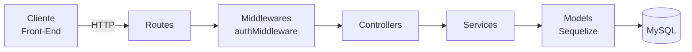

# Decisões de Projeto — Radar UFLA

> Sprint 4 — Issue [#26](https://github.com/Matheus-Castro-Paula/Radar-UFLA/issues/26) | Responsável: Tech Lead (`@BernarDEVthomaz`)

Este documento registra a decomposição do back-end em módulos e camadas, as principais decisões locais de projeto (no formato de ADRs) e a análise de coesão e acoplamento do código antes e depois da refatoração da Sprint 4.

## 1. Decomposição em camadas

O back-end (`API/Back-End/src`) é organizado em quatro camadas. Cada camada conversa apenas com a camada imediatamente abaixo dela.



| Camada          | Pasta              | Responsabilidade                                                                                                          | O que **não** deve fazer                                    |
| --------------- | ------------------ | ------------------------------------------------------------------------------------------------------------------------- | ----------------------------------------------------------- |
| **Routes**      | `src/routes/`      | Mapear verbo + URL para a função do controller e aplicar middlewares (ex.: `autenticarToken` nas rotas protegidas).       | Conter lógica de negócio ou acessar o banco.                |
| **Middlewares** | `src/middlewares/` | Tratar preocupações transversais antes do controller, como validar o token JWT e preencher `req.usuarioId`.              | Decidir regras de negócio do anúncio ou do usuário.         |
| **Controllers** | `src/controllers/` | Ler os dados da requisição (`req.body`, `req.params`, `req.usuarioId`), chamar o service e traduzir o resultado em status HTTP + JSON. | Validar regras de negócio, gerar hash/token ou consultar models diretamente. |
| **Services**    | `src/services/`    | Concentrar as regras de negócio (ex.: `RN-04` — LGPD, permissões de edição, status do anúncio). Não conhecem `req`/`res`. | Montar respostas HTTP ou depender do Express.               |
| **Models**      | `src/models/`      | Mapear as tabelas (`usuario`, `anuncio`, `foto_anuncio`, `comentario`) e suas associações via Sequelize.                  | Conter regras de negócio além de restrições de dados.       |

### Exemplo de fluxo: publicar um anúncio

1. `POST /api/anuncios` chega em `anuncioRoutes.js`, que aplica `autenticarToken` e chama `anuncioController.criar`.
2. O **controller** extrai os campos do corpo da requisição e o `req.usuarioId`, e chama `AnuncioService.criar(dados, usuarioId)`.
3. O **service** valida as regras de negócio — por exemplo, rejeita fotos quando a categoria é "Documentos pessoais" (`RN-04`) — e persiste via models.
4. O **model** `Anuncio` (e `FotoAnuncio`, quando houver fotos) grava no MySQL.
5. O service devolve o anúncio criado ou lança um erro de negócio; o controller converte isso em `201 Created` ou `400 Bad Request`.

## 2. Decisões de projeto (ADRs)

### ADR-01 — Criar uma camada de Serviços entre Controllers e Models

- **Status:** Aceita (Sprint 4)
- **Contexto:** Até a Sprint 3, os controllers concentravam tudo: leitura da requisição, validação, regras de negócio, acesso ao banco e montagem da resposta HTTP. O `authController.js` é o exemplo atual: a mesma função valida campos, consulta `Usuario`, gera hash com bcrypt, assina o JWT e monta o JSON. Com a chegada dos anúncios — que têm regras próprias como a `RN-04` (LGPD) — esse padrão faria o controller crescer e misturar responsabilidades.
- **Alternativas consideradas:**
  1. Manter a lógica nos controllers (MVC "magro", sem services).
  2. Colocar as regras de negócio nos models do Sequelize (hooks e métodos de instância).
  3. Criar uma camada `services/` com as regras de negócio, chamada pelos controllers.
- **Decisão:** Alternativa 3. Criar `src/services/` começando por `AnuncioService.js`; os controllers passam a apenas traduzir HTTP ↔ service.
- **Justificativa:** Separa "como a API responde" de "o que o sistema permite". As regras ficam em um só lugar, podem ser testadas sem subir o Express e podem ser reutilizadas por outras rotas. Regras nos models (alternativa 2) acoplariam o negócio ao ORM e esconderiam o comportamento em hooks difíceis de rastrear.
- **Consequências:**
  - ✅ Controllers menores e mais coesos; regras de negócio testáveis isoladamente.
  - ✅ Trocar o framework HTTP ou o ORM afeta só uma camada.
  - ⚠️ Mais arquivos e uma indireção a mais em cada fluxo.
  - ⚠️ O time precisa seguir a convenção: nenhuma regra de negócio nova no controller. Esse ponto passa a ser verificado no code review.

### ADR-02 — Autenticação stateless com JWT e senhas com bcrypt

- **Status:** Aceita (Sprint 3, registrada na Sprint 4)
- **Contexto:** Publicar, editar e excluir anúncios exige saber quem é o usuário. O front-end é composto de páginas estáticas (`API/Front-End`) que consomem a API via `fetch`, e o requisito `RNF-03` exige senhas em hash bcrypt.
- **Alternativas consideradas:**
  1. Sessão no servidor (`express-session`) com cookie.
  2. Token JWT assinado, enviado no cabeçalho `Authorization: Bearer <token>`.
  3. Login delegado a um provedor externo (OAuth / conta institucional).
- **Decisão:** Alternativa 2. O `authController` gera um JWT com `id`, `email` e `tipo_usuario` válido por 24h; o `authMiddleware` valida o token nas rotas protegidas. As senhas são guardadas apenas como `senha_hash` (bcrypt, custo 10).
- **Justificativa:** O JWT não exige armazenar sessão no servidor nem no banco, funciona bem com um front-end separado e com o container da API reiniciando no Docker. O bcrypt atende o `RNF-03`. O OAuth institucional dependeria de integração com a UFLA, fora do escopo da disciplina.
- **Consequências:**
  - ✅ API sem estado de sessão; qualquer rota pode ser protegida só adicionando `autenticarToken`.
  - ⚠️ Não é possível invalidar um token antes de expirar (logout real exigiria uma lista de bloqueio).
  - ⚠️ **Débito técnico:** a chave `JWT_SECRET` tem um valor padrão fixo no código e está duplicada em `authController.js` e `authMiddleware.js`. Deve ser obrigatória via `.env` e lida em um único módulo de configuração.

### ADR-03 — Aplicar a regra de LGPD (`RN-04`) no back-end, dentro do `AnuncioService`

- **Status:** Aceita (Sprint 4)
- **Contexto:** A regra `RN-04` determina que anúncios da categoria "Documentos pessoais" não podem expor foto do documento (ver `docs/modelagem/modelagem.md`, seção 2.3, e a Issue [#9](https://github.com/Matheus-Castro-Paula/Radar-UFLA/issues/9)). A regra precisa valer para qualquer cliente que acesse a API, não apenas para a tela de publicação.
- **Alternativas consideradas:**
  1. Validar apenas no front-end (esconder o campo de upload).
  2. Validar no controller de anúncios.
  3. Validar no `AnuncioService`, com o front-end apenas refletindo a regra.
  4. Permitir a foto com tarja, marcando o anúncio com um campo `contem_dado_sensivel`.
- **Decisão:** Alternativa 3. O `AnuncioService` rejeita a criação ou edição de anúncio da categoria "Documentos pessoais" que contenha fotos. O front-end bloqueia o campo de upload nessa categoria apenas para melhorar a experiência do usuário.
- **Justificativa:** Validação só no front-end (1) pode ser contornada chamando a API diretamente, o que deixaria a plataforma expor dados pessoais. No controller (2), a regra ficaria misturada ao HTTP e teria que ser repetida em criação e edição. A tarja (4) exigiria processamento de imagem e uma nova migration, fora do escopo. Centralizar no service garante uma única fonte da verdade.
- **Consequências:**
  - ✅ A regra vale para qualquer cliente e é testável sem interface.
  - ✅ Criação e edição reaproveitam a mesma validação.
  - ⚠️ A regra existe em dois lugares (service e interface); se mudar, ambos precisam ser atualizados. O back-end é a referência.
  - ⚠️ Documentos pessoais ficam apenas com descrição textual, o que pode dificultar a identificação do item pelo dono.

## 3. Análise de coesão e acoplamento

**Coesão** mede o quanto as responsabilidades de um módulo estão relacionadas entre si; o objetivo é coesão **alta** (cada módulo faz uma coisa). **Acoplamento** mede o quanto um módulo depende de detalhes de outros; o objetivo é acoplamento **baixo** (mudar um módulo afeta poucos outros).

### 3.1 Situação atual: `authController.js`

Commit de referência: [`7ebf6ea`](https://github.com/Matheus-Castro-Paula/Radar-UFLA/commit/7ebf6ea) — `API/Back-End/src/controllers/authController.js`

A função `registrar` executa, em sequência, cinco responsabilidades diferentes:

| Trecho                                                 | Responsabilidade               | Camada adequada |
| ------------------------------------------------------ | ------------------------------ | --------------- |
| `const { nome, email, senha, ... } = req.body`         | Ler a requisição HTTP          | Controller      |
| `if (!nome \|\| !email \|\| !senha)`                   | Validar dados de entrada       | Service         |
| `Usuario.findOne({ where: { email } })`                | Regra "e-mail único" + acesso ao banco | Service → Model |
| `bcrypt.hash(senha, 10)`                               | Regra de segurança (`RNF-03`)  | Service         |
| `res.status(201).json({ ... })`                        | Montar a resposta HTTP         | Controller      |

- **Coesão baixa:** o mesmo módulo mistura protocolo HTTP, regras de negócio, criptografia e persistência. Uma mudança na política de senha e uma mudança no formato da resposta alteram o mesmo arquivo.
- **Acoplamento alto:** o controller depende diretamente de `bcryptjs`, `jsonwebtoken` e do model `Usuario`. A constante `JWT_SECRET` está duplicada no controller e no `authMiddleware.js`, então os dois módulos precisam mudar juntos.

### 3.2 Antes e depois: `anuncioController.js` → `AnuncioService.js`

> **[A PREENCHER com as evidências dos devs back-end — Issues [#24](https://github.com/Matheus-Castro-Paula/Radar-UFLA/issues/24) e [#25](https://github.com/Matheus-Castro-Paula/Radar-UFLA/issues/25)]**

**Antes** — commit `[HASH]`

```js
// [COLAR AQUI o trecho do anuncioController.js com a regra de negócio dentro do controller]
```

**Depois** — commit `[HASH]`

```js
// [COLAR AQUI o anuncioController.js refatorado, apenas chamando o service]
```

```js
// [COLAR AQUI o trecho do AnuncioService.js com a regra RN-04 isolada]
```

| Critério                                | Antes | Depois |
| --------------------------------------- | ----- | ------ |
| Responsabilidades no controller         | `[A PREENCHER]` | `[A PREENCHER]` |
| Onde fica a regra `RN-04` (LGPD)        | `[A PREENCHER]` | `AnuncioService.js` |
| Dependências diretas do controller      | `[A PREENCHER]` | `[A PREENCHER]` |
| Regra testável sem subir o Express?     | Não   | Sim    |

**Análise:** `[A PREENCHER após a refatoração — explicar como a coesão do controller aumentou (só HTTP) e como o acoplamento diminuiu (controller deixa de depender de models e regras; o service não depende do Express).]`

### 3.3 Próximos passos

- Aplicar a mesma separação ao módulo de autenticação, criando um `AuthService` com as regras de cadastro e login.
- Centralizar a leitura de `JWT_SECRET` em `src/config/` e torná-la obrigatória via `.env` (ver débito técnico do ADR-02).
