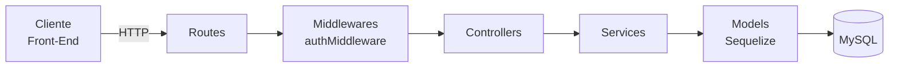

# Decisões de Projeto — Radar UFLA

> Sprint 4 — Issue [#26](https://github.com/Matheus-Castro-Paula/Radar-UFLA/issues/26) | Responsável: Tech Lead (`@BernarDEVthomaz`)
>
> **Atualizado na Sprint 5** — Issue [#32](https://github.com/Matheus-Castro-Paula/Radar-UFLA/issues/32): ADR-04 (Chain of Responsibility nas validações de anúncio, implementado no PR [#38](https://github.com/Matheus-Castro-Paula/Radar-UFLA/pull/38)) e melhorias M-05, M-06 e M-07. Detalhamento do padrão em [`padroes-de-projeto.md`](../padroes/padroes-de-projeto.md).
>
> **Atualizado na Sprint 6** — Issue [#40](https://github.com/Matheus-Castro-Paula/Radar-UFLA/issues/40): ADR-05 a ADR-08 (decisões de arquitetura global) e melhorias M-08 a M-14, identificadas ao documentar a arquitetura em [`arquitetura.md`](../arquitetura/arquitetura.md).

Este documento registra a decomposição do back-end em módulos e camadas, as principais decisões locais de projeto (no formato de ADRs), a análise de coesão e acoplamento do código antes e depois da refatoração da Sprint 4 e as melhorias identificadas.

**Arquivos de código afetados nesta sprint:**

| Arquivo                                                                                              | Papel                                                         | Issue                                                                                                                                                  |
| ---------------------------------------------------------------------------------------------------- | ------------------------------------------------------------- | ------------------------------------------------------------------------------------------------------------------------------------------------------ |
| [`services/AnuncioService.js`](../../API/Back-End/src/services/AnuncioService.js)                    | Regras de negócio de anúncios, incluindo a `RN-04`            | [#24](https://github.com/Matheus-Castro-Paula/Radar-UFLA/issues/24), [#25](https://github.com/Matheus-Castro-Paula/Radar-UFLA/issues/25) |
| [`services/RegraNegocioError.js`](../../API/Back-End/src/services/RegraNegocioError.js)              | Erro de negócio com código, sem dependência de HTTP           | [#24](https://github.com/Matheus-Castro-Paula/Radar-UFLA/issues/24)                                                                     |
| [`controllers/anuncioController.js`](../../API/Back-End/src/controllers/anuncioController.js)        | Tradução HTTP ↔ service                                       | [#24](https://github.com/Matheus-Castro-Paula/Radar-UFLA/issues/24)                                                                     |
| [`routes/anuncioRoutes.js`](../../API/Back-End/src/routes/anuncioRoutes.js)                          | Rotas `/api/anuncios` (leitura pública, escrita com JWT)      | [#24](https://github.com/Matheus-Castro-Paula/Radar-UFLA/issues/24)                                                                     |
| [`server.js`](../../API/Back-End/src/server.js)                                                      | Monta as rotas de anúncios                                    | [#24](https://github.com/Matheus-Castro-Paula/Radar-UFLA/issues/24)                                                                     |
| [`controllers/authController.js`](../../API/Back-End/src/controllers/authController.js)              | Referência do "antes" (não alterado nesta sprint)             | —                                                                                                                                       |

## 1. Decomposição em camadas

O back-end (`API/Back-End/src`) é organizado em quatro camadas. Cada camada conversa apenas com a camada imediatamente abaixo dela.



| Camada          | Pasta                                                        | Responsabilidade                                                                                                                                   | O que **não** deve fazer                                                    |
| --------------- | ------------------------------------------------------------ | -------------------------------------------------------------------------------------------------------------------------------------------------- | --------------------------------------------------------------------------- |
| **Routes**      | [`src/routes/`](../../API/Back-End/src/routes/)              | Mapear verbo + URL para a função do controller e aplicar middlewares (ex.: `autenticarToken` nas rotas de escrita).                                | Conter lógica de negócio ou acessar o banco.                                |
| **Middlewares** | [`src/middlewares/`](../../API/Back-End/src/middlewares/)    | Tratar preocupações transversais antes do controller, como validar o token JWT e preencher `req.usuarioId`.                                       | Decidir regras de negócio do anúncio ou do usuário.                         |
| **Controllers** | [`src/controllers/`](../../API/Back-End/src/controllers/)    | Ler os dados da requisição (`req.body`, `req.params`, `req.usuarioId`), chamar o service e traduzir o resultado ou o erro em status HTTP + JSON.    | Validar regras de negócio, gerar hash/token ou consultar models diretamente. |
| **Services**    | [`src/services/`](../../API/Back-End/src/services/)          | Concentrar as regras de negócio (`RN-04`, só o autor edita, até 3 fotos, categorias válidas). Lançam `RegraNegocioError`; não conhecem `req`/`res`. Desde a Sprint 5, as validações de anúncio ficam em [`services/validations/`](../../API/Back-End/src/services/validations/), como uma corrente de handlers (ADR-04). | Montar respostas HTTP ou depender do Express.                               |
| **Models**      | [`src/models/`](../../API/Back-End/src/models/)              | Mapear as tabelas (`usuarios`, `anuncio`, `foto_anuncio`, `comentario`) e suas associações via Sequelize.                                          | Conter regras de negócio além de restrições de dados.                       |

### Exemplo de fluxo: publicar um anúncio

1. `POST /api/anuncios` chega em [`anuncioRoutes.js`](../../API/Back-End/src/routes/anuncioRoutes.js), que aplica `autenticarToken` e chama `anuncioController.criar`.
2. O **controller** chama `AnuncioService.criar(req.body, req.usuarioId)`. Ele não importa nenhum model.
3. O **service** valida, nesta ordem: campos obrigatórios → `tipo`/`status` → categoria (normalizada e conferida contra a lista `objeto, eletronico, documento, material, outro`) → `RN-04` → fotos (até 3, JPG/PNG/WEBP). Qualquer violação lança `RegraNegocioError` com um código (`VALIDACAO`, `LGPD`, `PROIBIDO`, `NAO_ENCONTRADO`).
4. Se tudo estiver válido, o service grava `Anuncio` e `FotoAnuncio` em uma única transação.
5. O controller converte o resultado em `201 Created` ou, no caso de erro, o código em status: `VALIDACAO`/`LGPD` → 400, `PROIBIDO` → 403, `NAO_ENCONTRADO` → 404.

## 2. Decisões de projeto (ADRs)

| ADR    | Decisão                                         | Situação                                                                   | Issue                                                               | Commits                                                                                                                                                                                                                       |
| ------ | ----------------------------------------------- | -------------------------------------------------------------------------- | ------------------------------------------------------------------- | ----------------------------------------------------------------------------------------------------------------------------------------------------------------------------------------------------------------------------- |
| ADR-01 | Camada de Serviços entre Controllers e Models   | Implementada na Sprint 4                                                   | [#24](https://github.com/Matheus-Castro-Paula/Radar-UFLA/issues/24) | [`0bffa9f`](https://github.com/Matheus-Castro-Paula/Radar-UFLA/commit/0bffa9f)                                                                                                                                                |
| ADR-02 | Autenticação stateless com JWT + bcrypt         | Implementada na Sprint 3, registrada agora                                 | [#4](https://github.com/Matheus-Castro-Paula/Radar-UFLA/issues/4)   | [`7ebf6ea`](https://github.com/Matheus-Castro-Paula/Radar-UFLA/commit/7ebf6ea)                                                                                                                                                |
| ADR-03 | Regra `RN-04` (LGPD) no back-end, no service    | Implementada na Sprint 4                                                   | [#25](https://github.com/Matheus-Castro-Paula/Radar-UFLA/issues/25) | [`0bffa9f`](https://github.com/Matheus-Castro-Paula/Radar-UFLA/commit/0bffa9f), [`593156b`](https://github.com/Matheus-Castro-Paula/Radar-UFLA/commit/593156b)                                                                |
| ADR-04 | Chain of Responsibility nas validações de anúncio | Implementada na Sprint 5 (PR [#38](https://github.com/Matheus-Castro-Paula/Radar-UFLA/pull/38)) | [#30](https://github.com/Matheus-Castro-Paula/Radar-UFLA/issues/30), [#31](https://github.com/Matheus-Castro-Paula/Radar-UFLA/issues/31), [#32](https://github.com/Matheus-Castro-Paula/Radar-UFLA/issues/32) | [`c05a69c`](https://github.com/Matheus-Castro-Paula/Radar-UFLA/commit/c05a69c), [`e26c6aa`](https://github.com/Matheus-Castro-Paula/Radar-UFLA/commit/e26c6aa), [`cc1e2b3`](https://github.com/Matheus-Castro-Paula/Radar-UFLA/commit/cc1e2b3), [`d6b6a3d`](https://github.com/Matheus-Castro-Paula/Radar-UFLA/commit/d6b6a3d) |
| ADR-05 | Cliente-servidor com monólito em camadas | Implementada desde a estrutura inicial, registrada na Sprint 6 | [#40](https://github.com/Matheus-Castro-Paula/Radar-UFLA/issues/40) | [`f7c6b5d`](https://github.com/Matheus-Castro-Paula/Radar-UFLA/commit/f7c6b5d), [`79ac6af`](https://github.com/Matheus-Castro-Paula/Radar-UFLA/commit/79ac6af) |
| ADR-06 | MySQL com Sequelize e migrations | Implementada desde a estrutura inicial, registrada na Sprint 6 | [#40](https://github.com/Matheus-Castro-Paula/Radar-UFLA/issues/40) | [`4cb769c`](https://github.com/Matheus-Castro-Paula/Radar-UFLA/commit/4cb769c), [`4fcfdf3`](https://github.com/Matheus-Castro-Paula/Radar-UFLA/commit/4fcfdf3) |
| ADR-07 | Docker Compose para a API e o banco | Implementada desde a estrutura inicial, registrada na Sprint 6 | [#40](https://github.com/Matheus-Castro-Paula/Radar-UFLA/issues/40) | [`f7c6b5d`](https://github.com/Matheus-Castro-Paula/Radar-UFLA/commit/f7c6b5d) |
| ADR-08 | Fotos em volume local, gravadas após a validação | Aceita na Sprint 6, implementação em andamento | [#40](https://github.com/Matheus-Castro-Paula/Radar-UFLA/issues/40), [#41](https://github.com/Matheus-Castro-Paula/Radar-UFLA/issues/41), [#42](https://github.com/Matheus-Castro-Paula/Radar-UFLA/issues/42), [#43](https://github.com/Matheus-Castro-Paula/Radar-UFLA/issues/43) | — |

### ADR-01 — Criar uma camada de Serviços entre Controllers e Models

- **Status:** Aceita e implementada (Sprint 4)
- **Contexto:** Até a Sprint 3, o único controller do projeto, o [`authController.js`](../../API/Back-End/src/controllers/authController.js), concentrava tudo na mesma função: leitura da requisição, validação, consulta ao model `Usuario`, hash com bcrypt, assinatura do JWT e montagem da resposta HTTP. O módulo de anúncios, que começa nesta sprint, tem muito mais regras (`RN-04`, permissão do autor, limite de fotos, categorias válidas). Seguir o mesmo padrão faria o controller de anúncios crescer misturando responsabilidades.
- **Alternativas consideradas:**
  1. Manter a lógica nos controllers, como no `authController`.
  2. Colocar as regras de negócio nos models do Sequelize (hooks e métodos de instância).
  3. Criar uma camada `services/` com as regras de negócio, chamada pelos controllers.
- **Decisão:** Alternativa 3. Foi criada a pasta `src/services/` com o [`AnuncioService.js`](../../API/Back-End/src/services/AnuncioService.js). Os erros de negócio são representados por [`RegraNegocioError`](../../API/Back-End/src/services/RegraNegocioError.js), que carrega um código, e não um status HTTP. O [`anuncioController.js`](../../API/Back-End/src/controllers/anuncioController.js) só traduz HTTP ↔ service.
- **Justificativa:** Separa "como a API responde" de "o que o sistema permite". As regras ficam em um só lugar, podem ser testadas sem subir o Express e são reaproveitadas entre criação e edição. Regras nos models (alternativa 2) acoplariam o negócio ao ORM e esconderiam o comportamento em hooks difíceis de rastrear. O `RegraNegocioError` evita que o service precise saber que um erro de LGPD vira "400".
- **Consequências:**
  - ✅ Controller enxuto: cada função tem um `try`, uma chamada ao service e uma resposta.
  - ✅ Regras de negócio testáveis isoladamente; trocar o framework HTTP ou o ORM afeta só uma camada.
  - ⚠️ Mais arquivos e uma indireção a mais em cada fluxo.
  - ⚠️ O time precisa seguir a convenção (nenhuma regra de negócio nova no controller), verificada no code review.
  - ⚠️ O módulo de autenticação ainda segue o padrão antigo (ver melhoria M-01, seção 4).

### ADR-02 — Autenticação stateless com JWT e senhas com bcrypt

- **Status:** Aceita (implementada na Sprint 3, registrada na Sprint 4)
- **Contexto:** Publicar, editar e excluir anúncios exige saber quem é o usuário. O front-end é composto de páginas estáticas ([`API/Front-End`](../../API/Front-End/)) que consomem a API via `fetch`, e o requisito `RNF-03` exige senhas em hash bcrypt.
- **Alternativas consideradas:**
  1. Sessão no servidor (`express-session`) com cookie.
  2. Token JWT assinado, enviado no cabeçalho `Authorization: Bearer <token>`.
  3. Login delegado a um provedor externo (OAuth / conta institucional).
- **Decisão:** Alternativa 2. O [`authController`](../../API/Back-End/src/controllers/authController.js) gera um JWT válido por 24h com o `id` do usuário; o [`authMiddleware`](../../API/Back-End/src/middlewares/authMiddleware.js) valida o token e preenche `req.usuarioId`. As senhas são guardadas apenas como `senha_hash` (bcrypt, custo 10).
- **Justificativa:** O JWT não exige armazenar sessão no servidor nem no banco, funciona bem com um front-end separado e com o container da API reiniciando no Docker. O bcrypt atende o `RNF-03`. O OAuth institucional dependeria de integração com a UFLA, fora do escopo da disciplina.
- **Consequências:**
  - ✅ API sem estado de sessão; qualquer rota passa a ser protegida só adicionando `autenticarToken`, como foi feito nas rotas de escrita de `/api/anuncios`.
  - ✅ O `AnuncioService` usa o `req.usuarioId` vindo do token para aplicar a `RN-02` (só o autor edita ou exclui).
  - ⚠️ Não é possível invalidar um token antes de expirar (logout real exigiria uma lista de bloqueio).
  - ⚠️ **Débito técnico:** a chave `JWT_SECRET` tem um valor padrão fixo no código e está duplicada em `authController.js` e `authMiddleware.js` (ver melhoria M-02).

### ADR-03 — Aplicar a regra de LGPD (`RN-04`) no back-end, dentro do `AnuncioService`

- **Status:** Aceita e implementada (Sprint 4)
- **Contexto:** A regra `RN-04` ([`requisitos.md`](../requisitos/requisitos.md#5-regras-de-negócio)) determina que anúncios de documentos pessoais não podem expor foto do documento (ver também [`modelagem.md`](../modelagem/modelagem.md), seção 2.3, e a Issue [#9](https://github.com/Matheus-Castro-Paula/Radar-UFLA/issues/9)). Até a Sprint 3 a regra existia apenas no front-end: o [`app.js`](../../API/Front-End/app.js) esconde o campo de upload quando a categoria `documento` é escolhida. Qualquer cliente que chamasse a API diretamente conseguiria contorná-la.
- **Alternativas consideradas:**
  1. Manter a validação apenas no front-end.
  2. Validar no controller de anúncios.
  3. Validar no `AnuncioService`, com o front-end apenas refletindo a regra.
  4. Permitir a foto com tarja, marcando a foto com o campo `contem_dado_sensivel` (hoje comentado em [`foto_anuncio.js`](../../API/Back-End/src/models/foto_anuncio.js)).
- **Decisão:** Alternativa 3. A função `validarRegraLGPD` do `AnuncioService` rejeita, com o código `LGPD` (HTTP 400), anúncio da categoria `documento` que tenha fotos. Ela recebe o **estado final** do anúncio, então vale tanto na criação quanto na edição (por exemplo, um anúncio com foto que muda de categoria para `documento`). A categoria é normalizada (`trim` + minúsculas) e conferida contra uma lista fechada, para que variações como `"Documentos"` não escapem da regra. A vitrine pública devolve apenas `id` e `nome` do autor, nunca e-mail ou telefone.
- **Justificativa:** Validação só no front-end (1) pode ser contornada chamando a API diretamente, o que deixaria a plataforma expor dados pessoais. No controller (2), a regra ficaria misturada ao HTTP e teria que ser repetida em criação e edição. A tarja (4) exigiria processamento de imagem e uma nova migration, fora do escopo. Centralizar no service garante uma única fonte da verdade.
- **Consequências:**
  - ✅ A regra vale para qualquer cliente e é testável sem interface (10 cenários em [`sprint-04-api-anuncios.txt`](../sprints/evidencias/sprint-04-api-anuncios.txt)).
  - ✅ Criação e edição reaproveitam a mesma função.
  - ⚠️ A lista de categorias está duplicada entre o service e o `<select>` de [`publicar.html`](../../API/Front-End/publicar.html); se mudar, os dois precisam ser atualizados (ver melhoria M-03).
  - ⚠️ Documentos pessoais ficam apenas com descrição textual, o que pode dificultar a identificação do item pelo dono.
  - ⚠️ O comportamento observável mudou em relação ao texto original da `RN-04` ("fotos de documentos sem tarjas"), por isso `requisitos.md` e `modelagem.md` foram atualizados nesta sprint.

### ADR-04 — Adotar Chain of Responsibility nas validações de anúncio

- **Status:** Aceita e implementada (Sprint 5), no PR [#38](https://github.com/Matheus-Castro-Paula/Radar-UFLA/pull/38) (Issues [#30](https://github.com/Matheus-Castro-Paula/Radar-UFLA/issues/30) e [#31](https://github.com/Matheus-Castro-Paula/Radar-UFLA/issues/31)).
- **Contexto:** Depois da Sprint 4, o [`AnuncioService.js`](https://github.com/Matheus-Castro-Paula/Radar-UFLA/blob/593156b/API/Back-End/src/services/AnuncioService.js) concentra cerca de 80 linhas de validação e monta a sequência delas duas vezes: em `criar` (seis chamadas fixas) e em `atualizar` (quatro chamadas, duas delas com `if`). As duas sequências já divergem, e há pelo menos quatro regras novas do mesmo tipo identificadas (CPF no texto, data/hora obrigatória, limite de 5 MB e categorias gerenciadas), cada uma exigindo editar os dois métodos. Detalhes na seção 1 de [`padroes-de-projeto.md`](../padroes/padroes-de-projeto.md).
- **Alternativas consideradas:**
  1. Não usar padrão: manter as funções `validar*` e as chamadas dentro de `criar` e `atualizar` (ou um array de funções por operação).
  2. Strategy: uma estratégia de validação por operação (criação e edição).
  3. Chain of Responsibility: cada regra vira um handler com a mesma interface, e a corrente é montada em um único lugar.
- **Decisão:** Alternativa 3. Em `src/services/validations/` ficam a classe base [`ValidationHandler`](../../API/Back-End/src/services/validations/ValidationHandler.js) (`definirProximo`, `validar`), os handlers `CamposObrigatoriosHandler`, `CategoriaEStatusHandler`, `RegraLGPDHandler` e `FotosHandler`, e o montador [`AnuncioValidationChain`](../../API/Back-End/src/services/validations/AnuncioValidationChain.js), que encadeia os quatro uma única vez e expõe `executar(dados, contexto)`. O `AnuncioService` chama a corrente em `criar`, `atualizar` e `listar`, informando a operação em `contexto.acao`; cada handler decide se se aplica a ela. Na edição, os dados enviados à corrente são o estado final do anúncio. Os handlers continuam lançando `RegraNegocioError`.
- **Justificativa:** A alternativa 1 é a mais simples, mas deixa a composição das regras e as condições da edição espalhadas no service, e regra nova continua exigindo abrir `criar` e `atualizar`. Strategy (2) serve para escolher um entre vários algoritmos; aqui o problema é uma sequência de verificações, e cada estratégia teria que repetir a lista inteira (a `RN-04` estaria nas duas). Chain of Responsibility deixa o `AnuncioService` fechado para modificação quando surgir uma regra nova (OCP), dá a cada regra um único motivo para mudar (SRP) e reúne a ordem das validações em um só arquivo.
- **Consequências:**
  - ✅ Regra nova = handler novo + uma linha no `AnuncioValidationChain`; o `AnuncioService` não muda.
  - ✅ Criação, edição e listagem usam a mesma corrente, então não há mais duas sequências que possam divergir.
  - ✅ A `RN-04` ganha um arquivo próprio (`RegraLGPDHandler`), mais fácil de revisar e auditar.
  - ⚠️ Seis arquivos novos e uma indireção a mais para entender uma validação.
  - ⚠️ Cada handler precisa terminar chamando `super.validar(...)`; se um handler novo esquecer, os seguintes deixam de rodar sem nenhum erro. Item obrigatório do code review até a melhoria M-07.
  - ⚠️ A corrente para na primeira violação, então o usuário vê um erro por vez.
  - ⚠️ ADR-01 e ADR-03 continuam valendo: as regras seguem no service, com `RegraNegocioError` e sobre o estado final do anúncio. O ADR-04 só reorganiza onde elas moram.

### ADR-05 — Adotar arquitetura cliente-servidor com monólito em camadas

- **Status:** Aceita (implementada desde a estrutura inicial do projeto, registrada na Sprint 6)
- **Contexto:** O `RNF-06` exige uma arquitetura cliente-servidor modular. O sistema tem um único domínio (usuários, anúncios, fotos e comentários), é desenvolvido por cinco pessoas em um semestre e precisa ser executado facilmente para demonstração. A stack foi definida como restrição em [`visao-geral.md`](../visao-geral.md#5-restrições-e-premissas).
- **Alternativas consideradas:**
  1. Microsserviços, com autenticação e anúncios implantados separadamente.
  2. Clean Architecture ou Arquitetura Hexagonal completa, com portas e adaptadores.
  3. Monólito com páginas renderizadas no servidor (Express com templates).
  4. Monólito em camadas, expondo uma API REST consumida por um front-end estático.
- **Decisão:** Alternativa 4. O back-end é um único processo Node.js, organizado nas camadas routes, middlewares, controllers, services e models. O front-end é composto de páginas estáticas que consomem a API por `fetch`. A organização está nas seções 3 e 4 de [`arquitetura.md`](../arquitetura/arquitetura.md).
- **Justificativa:** Microsserviços trariam comunicação em rede, implantação separada e consistência distribuída sem ganho para um domínio pequeno e uma única equipe. A arquitetura hexagonal completa acrescentaria indireção desproporcional às regras atuais. A renderização no servidor uniria interface e API, dificultando a divisão de trabalho entre front-end e back-end. O monólito em camadas permite transações locais, uma única implantação e separação clara de responsabilidades.
- **Consequências:**
  - ✅ Uma única unidade de implantação para a API, com transações locais entre anúncio e fotos.
  - ✅ Front-end e back-end evoluem em paralelo, ligados pelo contrato HTTP.
  - ⚠️ Toda a API escala em conjunto, e uma falha no processo afeta todas as funcionalidades.
  - ⚠️ Front-end e API têm origens diferentes, o que exige CORS (ver melhoria M-10).
  - ⚠️ A separação entre camadas depende de convenção e de code review, como já indicado no ADR-01.

### ADR-06 — Persistir os dados em MySQL com Sequelize e migrations

- **Status:** Aceita (implementada desde a estrutura inicial do projeto, registrada na Sprint 6)
- **Contexto:** Os dados têm relacionamentos claros: um usuário publica vários anúncios, e um anúncio tem várias fotos e comentários. O `RNF-06` exige banco relacional, o `RNF-03` exige proteção contra injeção de SQL e a criação de um anúncio grava mais de uma tabela. Cinco pessoas precisam reproduzir o mesmo esquema em máquinas diferentes.
- **Alternativas consideradas:**
  1. Banco de documentos (MongoDB), com fotos e comentários embutidos no anúncio.
  2. MySQL com SQL escrito manualmente, usando apenas o driver `mysql2`.
  3. MySQL com Sequelize e migrations versionadas.
- **Decisão:** Alternativa 3. Os models ficam em [`src/models/`](../../API/Back-End/src/models/), as alterações de esquema em [`src/migrations/`](../../API/Back-End/src/migrations/) e a conexão em [`config.js`](../../API/Back-End/src/config/config.js).
- **Justificativa:** O banco de documentos contrariaria o `RNF-06` e deixaria a integridade entre usuários e anúncios a cargo da aplicação. O SQL manual exigiria cuidado individual em cada consulta para evitar injeção. O Sequelize oferece consultas parametrizadas, associações e transações, e as migrations tornam o esquema reproduzível em qualquer máquina.
- **Consequências:**
  - ✅ Integridade referencial e `ON DELETE CASCADE` garantidos pelo banco.
  - ✅ Anúncio e fotos gravados em uma única transação.
  - ✅ Esquema versionado junto com o código.
  - ⚠️ Os services dependem da API do Sequelize para consultas e transações.
  - ⚠️ Migrations já aplicadas não podem ser editadas; cada mudança exige uma migration nova (regra 12 de [`boundaries.md`](../../.harness/boundaries.md)).
  - ⚠️ A listagem de anúncios ainda não é paginada (ver melhoria M-12).

### ADR-07 — Usar Docker Compose para executar a API e o banco

- **Status:** Aceita (implementada desde a estrutura inicial do projeto, registrada na Sprint 6)
- **Contexto:** O `RNF-06` prevê a verificação do isolamento dos serviços no ambiente Docker. A aplicação depende de versões específicas de Node.js e MySQL, e a execução precisa ser reproduzível para a correção e a demonstração.
- **Alternativas consideradas:**
  1. Instalação manual de Node.js e MySQL em cada máquina.
  2. Docker apenas para o banco, com a API executada diretamente na máquina.
  3. Docker Compose com a API e o banco, mantendo o front-end fora do Compose.
  4. Docker Compose com a API, o banco e um servidor web para o front-end.
- **Decisão:** Alternativa 3. O [`docker-compose.yml`](../../API/Back-End/docker-compose.yml) define os serviços `db` e `backend`, e a API é construída pelo [`Dockerfile`](../../API/Back-End/Dockerfile). O front-end é servido à parte, como arquivos estáticos.
- **Justificativa:** A instalação manual causa diferenças de versão entre as máquinas, e a alternativa 2 resolve isso apenas para o banco. Em relação à alternativa 4, a opção adotada dispensa a configuração de um servidor web, pois o front-end não tem etapa de build e pode ser servido por qualquer servidor estático.
- **Consequências:**
  - ✅ A API e o banco sobem com um único comando e se comunicam pelo nome do serviço (`db`).
  - ✅ Os dados do banco persistem no volume `mysql_data`.
  - ⚠️ O front-end exige um comando separado para ser servido.
  - ⚠️ O arquivo define a senha do MySQL em texto e expõe a porta 3306 (ver melhoria M-11).
  - ⚠️ A configuração é voltada a desenvolvimento e demonstração: o código é montado por bind mount e não há TLS (ver melhoria M-08).

### ADR-08 — Armazenar as fotos em volume local, gravando após a validação

- **Status:** Aceita na Sprint 6, com implementação nas Issues [#41](https://github.com/Matheus-Castro-Paula/Radar-UFLA/issues/41), [#42](https://github.com/Matheus-Castro-Paula/Radar-UFLA/issues/42) e [#43](https://github.com/Matheus-Castro-Paula/Radar-UFLA/issues/43)
- **Contexto:** O `RF-08` prevê até 3 fotos de no máximo 5 MB por anúncio, e o `RNF-06` exige armazenamento seguro de mídias. Até a Sprint 5, as fotos chegavam à API como URLs, sem upload real. O item T-04 do backlog e a Issue [#10](https://github.com/Matheus-Castro-Paula/Radar-UFLA/issues/10) previam Multer com Cloudinary, enquanto as Issues da Sprint 6 preveem armazenamento local. A `RN-04` proíbe foto em anúncio de documento, portanto esse arquivo não pode permanecer no servidor.
- **Alternativas consideradas:**
  1. Serviço externo de mídia (Cloudinary).
  2. Imagens no MySQL, em colunas binárias.
  3. Disco local, gravando durante o recebimento (`diskStorage` do Multer).
  4. Disco local, mantendo o arquivo em memória e gravando somente após a validação (`memoryStorage` do Multer).
- **Decisão:** Alternativa 4. O `uploadMiddleware` mantém os arquivos em memória, a corrente de validação é executada e só então o `AnuncioService` grava em `/uploads`, volume persistente do Docker, e salva o caminho relativo em `foto_anuncio.url_imagem`. O Express serve a pasta por HTTP. O contrato entre as partes está na seção 5.4 de [`arquitetura.md`](../arquitetura/arquitetura.md).
- **Justificativa:** O Cloudinary oferece plano gratuito e CDN, mas exigiria conta e chaves para executar o projeto e tornaria a demonstração dependente de um serviço externo. Imagens no banco aumentariam o volume do MySQL e o custo das consultas. A gravação durante o recebimento deixaria em disco a foto de um documento recusado pela `RN-04`, mesmo com a requisição rejeitada. Com a alternativa 4, um arquivo recusado nunca chega ao disco.
- **Consequências:**
  - ✅ O projeto é executado sem conta ou credenciais de terceiros.
  - ✅ A `RN-04` continua valendo sem alteração no `RegraLGPDHandler`.
  - ⚠️ As fotos ficam presas à máquina que executa a aplicação, sem CDN e com backup manual do volume.
  - ⚠️ Cada requisição pode manter até 15 MB em memória.
  - ⚠️ Excluir um anúncio remove as linhas do banco, mas não os arquivos (ver melhoria M-13).
  - ⚠️ O MIME informado pelo cliente pode ser falsificado (ver melhoria M-14).
  - ⚠️ O README, o item T-04 do backlog e a Issue [#10](https://github.com/Matheus-Castro-Paula/Radar-UFLA/issues/10) ainda citam o Cloudinary e precisam ser atualizados.

## 3. Análise de coesão e acoplamento

A análise abaixo compara o padrão anterior do projeto com o novo módulo de anúncios, olhando três critérios em código concreto:

- **Responsabilidade:** quantas razões diferentes fazem o arquivo mudar.
- **Coesão:** se tudo o que o módulo faz está relacionado ao mesmo propósito.
- **Acoplamento:** de quantos detalhes de outros módulos ele depende.

> Não existia `anuncioController.js` antes da Sprint 4. Por isso o "antes" usa o `authController.js`, que representa o padrão adotado até então. Evidência completa, com os trechos de código: [`sprint-04-antes-depois.md`](../sprints/evidencias/sprint-04-antes-depois.md).

### 3.1 Antes: `authController.js` — commit [`7ebf6ea`](https://github.com/Matheus-Castro-Paula/Radar-UFLA/commit/7ebf6ea)

A função `registrar` de [`authController.js`](../../API/Back-End/src/controllers/authController.js) executa, em sequência, cinco responsabilidades diferentes:

| Trecho                                         | Responsabilidade                       | Camada adequada |
| ---------------------------------------------- | -------------------------------------- | --------------- |
| `const { nome, email, senha, ... } = req.body` | Ler a requisição HTTP                  | Controller      |
| `if (!nome \|\| !email \|\| !senha)`           | Validar dados de entrada               | Service         |
| `Usuario.findOne({ where: { email } })`        | Regra "e-mail único" + acesso ao banco | Service → Model |
| `bcrypt.hash(senha, 10)`                       | Regra de segurança (`RNF-03`)          | Service         |
| `res.status(201).json({ ... })`                | Montar a resposta HTTP                 | Controller      |

- **Responsabilidade:** o arquivo muda se mudar o formato da resposta, a política de senha, a regra de e-mail único ou o tempo de expiração do token.
- **Coesão baixa:** o mesmo módulo mistura protocolo HTTP, regras de negócio, criptografia e persistência.
- **Acoplamento alto:** o controller depende diretamente de `bcryptjs`, `jsonwebtoken` e do model `Usuario`. A constante `JWT_SECRET` está duplicada no controller e no `authMiddleware.js`, então os dois precisam mudar juntos.

### 3.2 Depois: `anuncioController.js` + `AnuncioService.js` — commits [`0bffa9f`](https://github.com/Matheus-Castro-Paula/Radar-UFLA/commit/0bffa9f) e [`593156b`](https://github.com/Matheus-Castro-Paula/Radar-UFLA/commit/593156b)

**Controller: só HTTP** ([`anuncioController.js`](../../API/Back-End/src/controllers/anuncioController.js))

```js
async criar(req, res) {
  try {
    const anuncio = await AnuncioService.criar(req.body, req.usuarioId);
    return res.status(201).json({ message: "Anúncio criado com sucesso!", anuncio });
  } catch (error) {
    return responderErro(res, error, "Erro ao criar anúncio.");
  }
}
```

**Service: regra `RN-04` isolada** ([`AnuncioService.js`](../../API/Back-End/src/services/AnuncioService.js))

```js
// RN-04 (LGPD): anúncio da categoria "documento" não pode ter foto.
// Recebe o estado FINAL do anúncio, então vale para criação e edição.
function validarRegraLGPD(categoria, fotos) {
  const ehDocumento = String(categoria).trim().toLowerCase() === CATEGORIA_DOCUMENTO;
  const temFotos = Array.isArray(fotos) && fotos.length > 0;

  if (ehDocumento && temFotos) {
    throw new RegraNegocioError(LGPD, "Não é permitido enviar foto de documento pessoal (RN-04 / LGPD). ...");
  }
}
```

| Critério                            | Antes (`authController`)                      | Depois (`anuncioController` + `AnuncioService`)                     |
| ----------------------------------- | --------------------------------------------- | ------------------------------------------------------------------- |
| Responsabilidades no controller     | HTTP + validação + banco + bcrypt + JWT       | Só HTTP: ler `req`, chamar o service, responder                     |
| Onde fica a regra `RN-04` (LGPD)    | Só no front-end (`app.js` / `publicar.html`)  | [`AnuncioService.js`](../../API/Back-End/src/services/AnuncioService.js) (`validarRegraLGPD`) |
| Dependências diretas do controller  | `bcryptjs`, `jsonwebtoken`, model `Usuario`   | Apenas `AnuncioService` e `RegraNegocioError`                       |
| Service depende do Express?         | — (não havia service)                         | Não: não recebe `req`/`res` e não conhece status HTTP               |
| Regra testável sem subir o Express? | Não                                           | Sim                                                                 |

**Análise:**

- **Coesão aumentou.** Cada função do `anuncioController` tem um único propósito: traduzir uma requisição em uma chamada ao service e o resultado em uma resposta. As regras de anúncio ficaram juntas no `AnuncioService`, cada uma em uma função pequena e nomeada (`validarCamposObrigatorios`, `validarCategoria`, `validarRegraLGPD`, `validarFotos`, `buscarAnuncioDoAutor`). A tabela de status (`STATUS_POR_CODIGO`) fica num único lugar do controller.
- **Acoplamento diminuiu.** O controller deixou de depender de models, do Sequelize e de bibliotecas de segurança: depende só da interface do service. O service, por sua vez, não depende do Express. A ligação entre as duas camadas é o `RegraNegocioError` com códigos de negócio, e não números HTTP, então mudar o status de um erro (por exemplo, a `RN-04` de 422 para 400, decidido na Issue #25) mexeu só no controller.
- **Responsabilidade ficou explícita.** Uma mudança na regra de LGPD altera apenas `validarRegraLGPD`; uma mudança no formato da resposta altera apenas o controller. A regra "só o autor edita ou exclui" (`RN-02`) está em um único ponto (`buscarAnuncioDoAutor`), usado por `atualizar` e `excluir`.

## 4. Melhorias e refatorações identificadas

| ID   | Melhoria                                                                                                                                         | Motivo                                                                                       | Prioridade |
| ---- | ------------------------------------------------------------------------------------------------------------------------------------------------ | -------------------------------------------------------------------------------------------- | ---------- |
| M-01 | Extrair um `AuthService` do `authController.js` (cadastro, login, hash e emissão do token)                                                       | O módulo de autenticação ainda tem a coesão baixa descrita na seção 3.1                      | Média      |
| M-02 | Ler `JWT_SECRET` em um único módulo de `src/config/` e torná-la obrigatória via `.env`, sem valor padrão                                         | Hoje a chave tem valor fixo no código e está duplicada em dois arquivos (ADR-02)            | Alta       |
| M-03 | Expor as categorias válidas por uma rota (ex.: `GET /api/categorias`) e montar o `<select>` de `publicar.html` a partir dela                    | Evitar a lista duplicada entre front-end e service (ADR-03); prepara o `RF-11`               | Baixa      |
| M-04 | Validar tamanho de arquivo (5 MB, `RF-08`) quando o upload real for implementado                                                                 | Hoje as fotos chegam como URLs, então o limite não é verificado (Issue #10). Com o ADR-04, entra como um handler novo | Média      |
| M-05 | Bloquear CPF e números de documento no título e na descrição também na API, como um handler da corrente (ADR-04)                                | Hoje essa checagem da `RN-04` só existe no front-end (`validarLGPDPublicacao` em `app.js`) e pode ser contornada chamando a API — a mesma situação que motivou o ADR-03 | Alta       |
| M-06 | Parar de devolver `details: error.message` nos erros 500 de `anuncioController.js` e `authController.js`; registrar o erro no servidor e responder com mensagem genérica | Expor detalhes internos ao cliente contraria a regra 6 de [`.harness/boundaries.md`](../../.harness/boundaries.md) | Média      |
| M-07 | Fixar o repasse da corrente na classe base (Template Method): `ValidationHandler.validar` chama um método `verificar` implementado por cada handler e depois repassa ao próximo | Hoje cada handler precisa lembrar de chamar `super.validar`; se esquecer, a corrente para em silêncio (ADR-04) | Média      |
| M-08 | Publicar a API atrás de um proxy reverso com HTTPS/TLS | O `RNF-03` exige TLS 1.3, e a API responde apenas em HTTP | Alta       |
| M-09 | Registrar log de auditoria das operações de alteração e exclusão, com timestamp UTC, usuário e IP | Exigido pelo `RNF-04` e inexistente no código | Média      |
| M-10 | Restringir o CORS à origem do front-end e usar a variável `PORT` em `server.js` | `cors()` aceita qualquer origem, e a porta 3000 está fixa no código, apesar de `PORT` existir no `.env.example` (ADR-05) | Média      |
| M-11 | Retirar a senha do MySQL do `docker-compose.yml`, usar um usuário próprio da aplicação e não expor a porta 3306 | A senha em texto contraria a regra 5 de [`.harness/boundaries.md`](../../.harness/boundaries.md) (ADR-07) | Alta       |
| M-12 | Paginar `GET /api/anuncios` e levar busca e filtros ao servidor | A vitrine carrega todos os anúncios ativos e filtra no navegador, o que limita o `RNF-02` com o crescimento da base (ADR-06) | Média      |
| M-13 | Remover de `/uploads` os arquivos das fotos ao excluir um anúncio ou substituir suas fotos | A exclusão em cascata apaga as linhas do banco, mas não os arquivos (ADR-08) | Média      |
| M-14 | Conferir a assinatura real do arquivo, além do MIME informado | O MIME enviado pelo cliente pode ser falsificado (ADR-08) | Baixa      |
